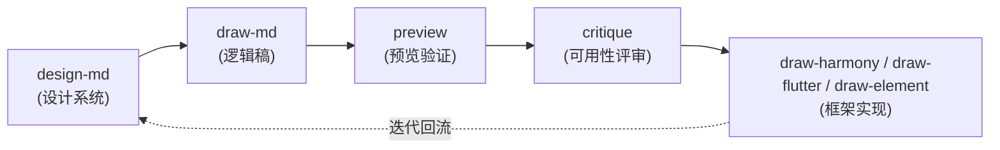

# Maliang（马良）— 前端设计生成技能

> 覆盖 UIUX 全生命周期的设计系统 skill（研究→定义→设计→实现→验证→交付→迭代）：`DESIGN.md` 设计系统 + 页面级硬 token UI markdown + 三框架代码适配，一条流水线跑通。

[](https://github.com/Kirky-X/maliang/tags) [](LICENSE) [](scripts/)

中文 | [English](README_EN.md)

## ✨ 功能特性

**13 个子命令**覆盖全生命周期（完整路由表见 [SKILL.md](SKILL.md)）：

| 子命令 | 阶段 | 功能 |
| ------ | ---- | ---- |
| `design-md` | 定义 | 创建/应用/验证/导出 prose-first 的 DESIGN.md（YAML token + 设计理由，含 persona/journey/JTBD 用户研究） |
| `redesign` | 迭代 | 改版现有 UI：10 维审计 + Refresh / Restructure / Rebuild / Deslop（去 AI 味）四模式 |
| `component` | 设计 | 单个组件 brief（做个按钮 / 单个输入框 / toast 等单元素，8 状态硬门），走组件流程替代 draw-md 页面机制 |
| `explore` | 定义 | 方向未定时多方案发散-比较-收敛：实体化 3–5 个真不同方案 → preview 渲染比较 → 选定胜者（见 [explore.md](references/commands/explore.md)） |
| `draw-md` | 设计 | 从 DESIGN.md 产出页面级硬 token UI markdown（颜色/字体/间距全引用 token） |
| `preview` | 验证 | Element Plus + iOS/Android 设备外壳实时预览 |
| `critique` | 验证 | Nielsen 10 启发式 0–4 评分 + persona 走查 + 认知负荷清单，产出评分快照/趋势/backlog |
| `draw-harmony` / `draw-flutter` / `draw-element` | 实现 | 转换为 HarmonyOS(ArkTS) / Flutter(Dart) / Element Plus(Vue 3) 框架代码 |
| `ui-graph` | 交付 | UI 关系图（层级 + 跳转 + 哈希基线 + 实现映射），变更追踪与实现缺口查询 |
| `ip` / `ip-handbook` | 交付 | IP 形象生成（API 优先，fallback prompt）/ IP 视觉手册（8 模块，2K 3:4） |

- **设计资产库**：14 种设计语言模板墙（液态玻璃 / M3 Expressive / Fluent 2 / Bento / 瑞士编辑 / OLED 暗色等）+ 30 篇组件命名词汇 + 九维规范（色/字/图/距/角/线/布局/对齐/海拔）
- **区段原型库**：[`references/components/`](references/components/INDEX.md)（51 个区段原型 + 索引——**从索引挑名、只加载选中的那几个**，典型一次构建 5-7 个文件：1 hero + 1 区段头 + 1-2 主体区段 + 1 CTA + 1 页脚 + 1 导航；区段原型管「这段长成什么」，元素级外观仍在 `references/vocabulary/`）
- **三框架组件文档**：56 类组件 × HarmonyOS/Flutter/Element Plus（`references/framework/`）
- **craft 纪律与评审**：[`references/interface-design/`](references/interface-design/)（产品 UI craft 纪律与严格评审/去 slop 深流程）；Web 界面规则快照在 [`references/meta/web-interface-guidelines.md`](references/meta/web-interface-guidelines.md)，critique 的 UI 合规/a11y 清单读取该快照
- **脚本验证层**：`validate.py draw-md`（23 项检查）、`preview.py check`（51/143 项可脚本化，含 WCAG 对比度）、`ui-graph.py`（9 子命令，含 check-sync 规格↔实现同步判定与 token-usage 波及分析）、`validate.py generated`（生成码校验 + G46 注入面扫描）、`ci-gate.sh` 统一入口——纯 Python 标准库
- **第二批验证脚本**（同标准库）：`verify.py color-fidelity`（重建 vs 参考图 ΔE 保真门）、`verify.py measure-colors`（图片确定性测色）、`verify.py palette-solver`（OKLCH 亮度求解 + 配对矩阵）、`verify.py assets`（资产位在场验证）、`audit.py fingerprint`（重审计源码指纹）、`audit.py structure-history`（轮换重复 / 热轴 / 盖章真伪）、`audit.py copy`（句型级反模板）
- **新增参考层**：[`references/meta/source-hygiene.md`](references/meta/source-hygiene.md)（来源卫生：拒载名单 / 私网拒绝 / junk 信号 / Provenance）、[`references/meta/visual-symptoms.md`](references/meta/visual-symptoms.md)（感知症状 → 病灶 → 修复）
- **辅助脚本**：`install-skill.sh`（安装器，见下文安装）、`design-md.py`（design-md 域合并入口：token-md / extract-tokens / derive-dark / validate 四子命令）、`skill_lint.py`（仓库级 SKILL.md 工程体检）、`style-ledger.py`（跨项目外观账本）、`version-check.py`（版本检查确定性逻辑）

## 📦 安装

```bash
# 方式 1：仓库自带安装器（安装到目标项目的 agent 目录，支持 claude/cursor/windsurf 等 9 类 agent，默认 --target . --agent claude）
bash scripts/install-skill.sh install maliang --target <项目目录>

# 方式 2：手动拷贝到 agent 技能目录
cp -r maliang/ ~/.zcode/skills/maliang/

# 方式 3：远程安装（GitHub 仓库）
npx skills add Kirky-X/maliang --agent claude-code -y
```

首跑依赖：仅需 Python 3.8+（脚本层全部标准库），无 requirements.txt。

## 🚀 快速开始

前置：skill 已部署到 agent 技能目录；`{SKILL_DIR}` 指安装目录，`--target` 指向用户项目产物目录（canonical 为 `.maliang/ui-markdown/`，布局契约见 `references/meta/workspace-layout.md`；禁止拿 skill 自带 `examples/` 当分析目标）。

```text
为这个项目创建 DESIGN.md               # → design-md
出首页和设置页的 UI markdown            # → draw-md（需先有 DESIGN.md）
审查一下这个页面的可用性                # → critique（Nielsen 10 + persona 走查）
把这个页面转成 HarmonyOS 代码           # → draw-harmony
```

脚本层可直接独立运行：

```bash
python3 {SKILL_DIR}/scripts/ui-graph.py generate --target .maliang/ui-markdown/      # 生成 UI 关系图
python3 {SKILL_DIR}/scripts/ui-graph.py check-nav --target .maliang/ui-markdown/     # 导航死链检查
python3 {SKILL_DIR}/scripts/validate.py draw-md .maliang/ui-markdown/ --format text  # 23 项规范性检查
bash {SKILL_DIR}/scripts/ci-gate.sh                                          # CI 验证门（单测 + 三验证器）
```

### 全景流程（mermaid）



## ✅ 测试与验证

pytest 实测（2026-11-03，Python 3.12）：

```text
$ python3 -m pytest tests -q
629 passed, 17 skipped in 11.44s
```

测试文件清单以 [`tests/`](tests) 单一来源为准（计数一致性由 `test_doc_consistency` 断言守护）；本批新增验证层脚本各有对应测试与 fixtures。

CI 门实测：`bash scripts/ci-gate.sh` → `结果: PASS`（单元测试 ✓、validate-draw-md ✓、validate-framework △ 仅 warning、ui-graph check-nav ✓、preview-check 0 error / 3 warning、detect-tells 冒烟 ✓，覆盖 51/143 项，其余需浏览器人工验证）。push/PR 由 `.github/workflows/validate.yml` 自动执行同一门禁。

## 📁 目录结构

```text
maliang/
├── SKILL.md                 # 入口：13 子命令路由 + meta 加载时序 + 失败模式 + 禁止事项
├── skill.json               # 元数据（MIT）
├── references/
│   ├── commands/            # 13 份子命令流程文档 + 2 份附属文档（design-md-advanced / preview-checklist）
│   ├── meta/                # 规范层：token / principles / ux-rules / lifecycle / accessibility …
│   │                        #   含 web-interface-guidelines.md 快照（钉定信息见文件头部）
│   │                        #   + source-hygiene.md（来源卫生）/ visual-symptoms.md（症状诊断）
│   ├── interface-design/    # 原 craft 方法集 并入（craft 纪律 / 严格评审）
│   ├── dimensions/          # 九维规范 + 调色板库 + 液态玻璃配方
│   ├── framework/           # 56 类组件 × 三框架文档（harmony / flutter / element）
│   ├── components/          # 区段原型库：51 个原型 + INDEX.md（从索引挑名、只加载选中的那几个）
│   ├── templates/           # 模板墙：14 种设计语言 + 整页模式 + 落地页编排
│   ├── vocabulary/          # 30 篇组件命名词汇（含 pro-motion 专业交互、chat 对话消息）
│   └── default-pages/       # 默认页面清单（App/Web 各 15 页，P0–P2）
├── scripts/                 # 验证层：preview-check / preview-lint.js / verify-states / verify-interactive / design-md(合并入口) / validate-generated / evidence-check / receipts / check-claims / ledger / build-explorer / preview-server / detect-tells / ci-gate（退出码 canonical 见 scripts/EXIT-CODES.md）；第二批：verify-color-fidelity / measure-colors / palette-solver / verify-assets / source-fingerprint / check-structure-history / check-copy；基础层：ui-graph / validate-draw-md / validate-framework / install-skill / skill_lint / device_models / maliang_common / devices/
├── examples/                # 12 种设计系统示例 + 端到端链路产物（ui-markdown → preview → Vue，第一代布局历史实例）
#   用户项目运行时产物统一落 <项目根>/.maliang/（DESIGN.md + ui-markdown/ + preview/ + critique/ + ip/ + ip-handbook/）
└── tests/                   # pytest 套件（646 用例，39 文件）
```

## 🧭 维护归属

每条规则只有一个 canonical 文档；复述位置由 `scripts/audit.py claims` 与 `skill_lint.py` 的 count-matches 规则对账，禁止手改分叉：

| 规则 / 机制 | canonical 文档 |
| --- | --- |
| 设计语言计数（模板墙） | `references/templates/INDEX.md` |
| 设计语言 token 配方（阴影/圆角等值级参数） | `references/templates/`（各语言模板文件；`examples/design-system/` 范例引用模板配方，不自持一套值） |
| 编号门禁 G01–G45 | `references/meta/numbered-gates.md` |
| 143 项 Pre-Flight 清单与计数 | `references/commands/preview-checklist.md`（脚本侧计数由 `tests/test_doc_consistency.py` 断言守护） |
| 退出码三态语义 | `scripts/EXIT-CODES.md` |
| token 溯源与决策 id | `references/meta/token-provenance.md` |
| 品牌供体值库 | `references/donors/README.md` |
| 用户反馈账本 | `references/meta/feedback-ledger.md` |
| 取证 / 验证流程 | `references/commands/preview.md` + `preview-checklist.md` |

## 🔮 边界

- **不适用**：无 UI 的后端/脚本/数据任务、纯文案写作、非视觉类代码生成
- **一次性改版**：maliang 的 redesign 命令同时覆盖持续改版（回流 decisions 账本）与不沉淀 token 的一次性翻新（Refresh / Deslop 模式）
- **代码质量/架构审查**归 [diting](../diting/)；**安全扫描**归 [tiangang](../tiangang/)
- **流程硬约束**：无 DESIGN.md 严禁直接进入 draw-md / draw-* 下游（token 引用悬空）；禁止硬编码颜色/字号/间距，一律 `{token-name}` 占位

## 📄 License 与归属

MIT License（© 2026 Kirky-X）。

**致谢**（第三方内容与规则的取材对象，仅此处在案）：

- interface-design —— `references/interface-design/` 的 craft 纪律与严格评审流程
- awesome-design-md —— `references/donors/candidates/` 快照集的上游
- Vercel Web Interface Guidelines —— `references/meta/web-interface-guidelines.md` 的本地快照底本
- taste-skill、emilkowalski/skills、unslop、hallmark、ui-ux-pro-max-skill —— 动效与设计规则经蒸馏改写融入本仓
- Laws of UX、Apple Human Interface Guidelines、HarmonyOS 应用设计、GOV.UK Design System、Nielsen Norman Group、IBM Carbon、Atlassian、Material Design —— 规则与定律的参考文献

上述第三方内容均依其原有许可条款使用，署名与许可条款见各来源项目。
