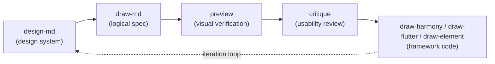

# Maliang — Frontend Design Generation Skill

> A design-system skill covering the full UIUX lifecycle (research → define → design → implement → verify → deliver → iterate): `DESIGN.md` design system + page-level hard-token UI markdown + framework code for three targets, one pipeline end to end.

[](https://github.com/Kirky-X/maliang/tags) [](LICENSE) [](scripts/)

English | [中文](README.md)

## ✨ Features

**13 subcommands** covering the full lifecycle (full routing table in [SKILL.md](SKILL.md)):

| Subcommand | Stage | Function |
| ---------- | ----- | -------- |
| `design-md` | Define | Create/apply/validate/export a prose-first DESIGN.md (YAML tokens + design rationale, with persona/journey/JTBD user research) |
| `redesign` | Iterate | Revamp existing UI: 9-dimension audit + Refresh / Restructure / Rebuild / Deslop (AI-slop removal) modes |
| `component` | Design | Single-component brief (a button / a single input / toast and the like, 8-state hard gate), component flow instead of draw-md's page machinery |
| `explore` | Define | When direction is undecided: diverge 3–5 genuinely different options → compare via preview renders → commit to the winner (see [explore.md](references/commands/explore.md)) |
| `draw-md` | Design | Produce page-level hard-token UI markdown from DESIGN.md (colors/fonts/spacing all token-referenced) |
| `preview` | Verify | Live preview with Element Plus inside iOS/Android device shells |
| `critique` | Verify | Nielsen 10 heuristics scored 0–4 + persona walkthrough + cognitive-load checklist; emits score snapshots/trends/backlog |
| `draw-harmony` / `draw-flutter` / `draw-element` | Implement | Convert to HarmonyOS(ArkTS) / Flutter(Dart) / Element Plus(Vue 3) framework code |
| `ui-graph` | Deliver | UI relationship graph (hierarchy + navigation + hash baseline + implementation map), change tracking and implementation-gap queries |
| `ip` / `ip-handbook` | Deliver | IP character generation (API first, prompt fallback) / IP visual handbook (8 modules, 2K 3:4) |

- **Design asset library**: template wall with 14 design languages (liquid glass / M3 Expressive / Fluent 2 / Bento / Swiss editorial / OLED dark, etc.) + 24 component-naming vocabulary docs + nine dimension specs (color / type / icon / spacing / radius / border / layout / alignment / elevation)
- **Section-archetype library**: [`references/components/`](references/components/INDEX.md) (51 section prototypes + index — **pick names from the index, load only the ones you picked**; a typical build touches 5-7 files: 1 hero + 1 section header + 1-2 body sections + 1 CTA + 1 footer + 1 nav; archetypes decide how a section looks, element-level styling stays in `references/vocabulary/`)
- **Three-framework component docs**: 56 component classes × HarmonyOS/Flutter/Element Plus (`references/framework/`)
- **Merged assets**: the former craft 方法集 now lives in [`references/interface-design/`](references/interface-design/) (product-UI craft discipline and strict review / de-slop deep process); a Vercel Web Interface Guidelines snapshot sits at [`references/meta/web-interface-guidelines.md`](references/meta/web-interface-guidelines.md) (pin info lives solely in that file's header), critique reads it for UI-compliance/a11y checklists
- **Script verification layer**: `validate-draw-md.py` (23 checks), `preview-check.py` (51/143 items scriptable, incl. WCAG contrast), `ui-graph.py` (9 subcommands, incl. check-sync spec↔implementation sync and token-usage impact analysis), `validate-generated.py` (generated-code checks + G46 injection-surface scan), `ci-gate.sh` unified entry — pure Python standard library
- **Second-batch verification scripts** (same standard library): `verify.py color-fidelity` (rebuild-vs-reference ΔE fidelity gate), `verify.py measure-colors` (deterministic image color measurement), `verify.py palette-solver` (OKLCH brightness solver + pairing matrix), `verify.py assets` (asset-slot presence check), `audit.py fingerprint` (source fingerprint for re-audits), `audit.py structure-history` (rotation repeats / hot axis / stamp truth), `audit.py copy` (template-phrase scanner)
- **New reference layer**: [`references/meta/source-hygiene.md`](references/meta/source-hygiene.md) (source hygiene: blocklist / private-network rejection / junk signals / Provenance), [`references/meta/visual-symptoms.md`](references/meta/visual-symptoms.md) (perceived symptom → root cause → fix)
- **Auxiliary scripts**: `install-skill.sh` (installer, see Installation below), `design-md.py` (design-md domain merged entry: token-md / extract-tokens / derive-dark / validate subcommands), `skill_lint.py` (repo-level SKILL.md hygiene lint), `style-ledger.py` (cross-project style ledger), `version-check.py` (deterministic version-check logic)

## 📦 Installation

```bash
# Option 1: bundled installer (installs into a target project's agent directory; 9 agent types incl. claude/cursor/windsurf, defaults --target . --agent claude)
bash scripts/install-skill.sh install maliang --target <project-dir>

# Option 2: manual copy into an agent skills directory
cp -r maliang/ ~/.zcode/skills/maliang/

# Option 3: Remote install (GitHub repo)
npx skills add Kirky-X/maliang --agent claude-code -y
```

First-run requirements: Python 3.8+ only (scripts use the standard library exclusively); no requirements.txt.

## 🚀 Quick Start

Prerequisite: the skill is deployed to an agent skills directory; `{SKILL_DIR}` is the install directory and `--target` points at the user's project (never analyze the skill's own `examples/`).

```text
Create a DESIGN.md for this project          # → design-md
Produce UI markdown for home and settings    # → draw-md (requires DESIGN.md first)
Review this page's usability                 # → critique (Nielsen 10 + persona walkthrough)
Convert this page to HarmonyOS code          # → draw-harmony
```

The script layer runs standalone too:

```bash
python3 {SKILL_DIR}/scripts/ui-graph.py generate --target ui-markdown/      # build the UI relationship graph
python3 {SKILL_DIR}/scripts/ui-graph.py check-nav --target ui-markdown/     # navigation dead-link check
python3 {SKILL_DIR}/scripts/validate-draw-md.py ui-markdown/ --format text  # 15 compliance checks
bash {SKILL_DIR}/scripts/ci-gate.sh                                          # CI gate (tests + 3 validators)
```

### Pipeline Overview (mermaid)



## ✅ Tests & Verification

Measured pytest run (2026-10-20, Python 3.12):

```text
$ python3 -m pytest tests -q
445 passed, 1 skipped in 13.13s
```

Test files: see [`tests/`](tests) (single source; counts guarded by `test_doc_consistency`).

CI gate measured: `bash scripts/ci-gate.sh` → `Result: PASS` (unit tests ✓, validate-draw-md ✓, validate-framework △ warnings only, ui-graph check-nav ✓, preview-check 0 errors / 3 warnings covering 51/143 items — the rest need browser-based manual verification). Push/PR runs the same gate automatically via `.github/workflows/validate.yml`.

## 📁 Directory Structure

```text
maliang/
├── SKILL.md                 # Entry: 13-subcommand router + meta load order + failure modes + prohibitions
├── skill.json               # Metadata (MIT)
├── references/
│   ├── commands/            # 13 subcommand workflow docs + 2 auxiliary docs (design-md-advanced / preview-checklist)
│   ├── meta/                # Spec layer: token / principles / ux-rules / lifecycle / accessibility …
│   │                        #   incl. web-interface-guidelines.md snapshot (pin info in the file header)
│   │                        #   + source-hygiene.md (source hygiene) / visual-symptoms.md (symptom diagnosis)
│   ├── interface-design/    # merged from the former craft 方法集 (craft discipline / strict review)
│   ├── dimensions/          # nine dimension specs + palette library + liquid-glass recipes
│   ├── framework/           # 56 component classes × three frameworks (harmony / flutter / element)
│   ├── components/          # section-archetype library: 51 prototypes + INDEX.md (pick from the index, load only what you pick)
│   ├── templates/           # template wall: 14 design languages + full-page patterns + landing-page orchestration
│   ├── vocabulary/          # 24 component-naming vocabulary docs (incl. pro-motion, chat)
│   └── default-pages/       # default page lists (15 app + 15 web pages, P0–P2)
├── scripts/                 # verification layer: preview-check / preview-lint.js / verify-states / verify-interactive / design-md (merged entry) / validate-generated / evidence-check / receipts / check-claims / ledger / build-explorer / preview-server / detect-tells / ci-gate (exit-code canonical: scripts/EXIT-CODES.md); second batch: verify-color-fidelity / measure-colors / palette-solver / verify-assets / source-fingerprint / check-structure-history / check-copy; base layer: ui-graph / validate-draw-md / validate-framework / install-skill / skill_lint / device_models / maliang_common / devices/
├── examples/                # 12 design-system examples + end-to-end artifacts (ui-markdown → preview → Vue)
└── tests/                   # pytest suite (445 cases, 31 files)
```

## 🔮 Boundaries

- **Not applicable**: backend/script/data tasks without UI, pure copywriting, non-visual code generation
- **One-shot revamps**: maliang's redesign command covers both continuous iteration (flowing back into the decisions ledger) and one-shot refreshes without token persistence (Refresh / Deslop modes)
- **Code quality/architecture review** belongs to [diting](../diting/); **security scanning** to [tiangang](../tiangang/)
- **Hard workflow constraints**: never enter draw-md / draw-* downstream without a DESIGN.md (dangling token references); hard-coded colors/fonts/spacing are forbidden — always `{token-name}` placeholders

## 📄 License & Attribution

MIT License (© 2026 Kirky-X). `references/interface-design/` comes from the merged former craft 方法集; `references/meta/web-interface-guidelines.md` is a local snapshot of the [Vercel Web Interface Guidelines](https://github.com/vercel-labs/web-interface-guidelines) (pin info in the file header).
