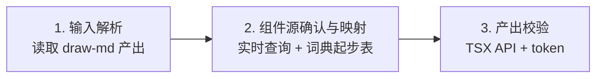

# draw-react 子命令 —— 将逻辑 UI 转换为 React 生态(shadcn/ui · Motif · Astryx)实现

> 本文件是 `draw-react` 子命令的完整流程,由顶层 [`SKILL.md`](../../SKILL.md) 路由进入。
> 输入 = `draw-md` 产出的页面级 UI markdown(`.maliang/ui-markdown/` 下),输出 = React 生态 TSX 实现代码。
> 组件文档获取按 [`adapter-contract.md`](../framework/adapter-contract.md)「查询契约」执行:**官网实时抓取为事实源**;React 三源无 bundled 快照,不建持久缓存。
> **API 语义准绳**:复制粘贴型(shadcn/Motif)以**项目内 `components/ui/` 实际源码为准**,官网文档只作 API 语义参考;npm 型(Astryx)以 package.json 已装版本为准,超基线 API 按 [`framework/INDEX.md`](../framework/INDEX.md)「超基线 API 两级语义」处理。

---

> **CHECKPOINT 与无人值守**:无人值守时按 [`SKILL.md`](../../SKILL.md)「无人值守与 CHECKPOINT 降级」节的默认取值表执行,不逐点阻塞;自选决定与理由写入交付说明。

## 流程概览(三段式)



---

## 1. 输入解析

读取 `draw-md` 产出的页面 markdown(位于 `.maliang/ui-markdown/ui/` 下):

1. **解析 frontmatter** — 提取 `name`、`description`、`background`、`updated`、`version`
2. **解析 token.md** — 读取 `.maliang/ui-markdown/token.md`,建立 token 名→语义变量映射表(颜色/字体/间距/圆角)
3. **解析布局章节** — 按"顶部导航 → 主体区块 → 底部 dock"顺序,逐章提取组件类型与参数表

**🔴 CHECKPOINT · 输入解析确认**:确认 UI markdown + token.md 已读取,展示组件源与映射预案(逻辑组件 → 组件源原生组件)供用户确认,再进入代码生成。

---

## 2. 组件源确认与映射

### 组件源确认(用户强制指定门,先于一切映射)

React 运行时挂三个组件源(shadcn/ui · Motif · Astryx,见 [`adapter-contract.md`](../framework/adapter-contract.md)「两层结构」)。目标源未指定时按契约执行:

1. 探测用户项目:npm 型读 `package.json` 依赖(`@astryxdesign/core` 等);复制粘贴型读 `components.json` 存在性或 `components/ui/` 目录(shadcn/Motif);
2. 按 [`framework/INDEX.md`](../framework/INDEX.md)「运行时 × 组件源两级选型表」呈现候选——已装的排前,每项附适用场景与风险标记;
3. **由用户指定最终组件源**——skill 只提醒"哪个更优",不得自动锁定;
4. 指定结果回写 DESIGN.md 决策账本(按 [`../meta/token-provenance.md`](../meta/token-provenance.md) 决策 id 制式 `D-P<原则序号>-<决策序号>`,含选定源与探测证据);账本已有选择时直接复用,不再重问;
5. 主源缺某类组件(如 shadcn 缺 agent 对话部件)→ 提示补充源候选(→Motif),经用户确认后混用并标注混合来源;混用边界遵守选型表「混用规则」(Astryx 不与 Tailwind 系混)。

### 组件映射(三级查询通道)

1. **官网实时抓取**(事实源)— 按组件源 ingest 通道:shadcn/ui 抓官方文档页与 registry JSON;Motif 抓 `llms.txt` 索引与任意 URL 加 `.md` 端点;Astryx 抓 astryx.atmeta.com 组件文档页。取用法 + Props/事件表;
2. **快照回退** — React 三源**无 bundled 快照,本级跳过**(显式说明,不假装回退);
3. **显式报错 + 组合兜底** — 实时抓取失败:显式报错(不静默),改用基础组件组合实现,标注「无原生对应,本方案为组合」。

会话内查询去重:同一任务内以「运行时 × 组件源 × 组件」为键内存去重,任务结束即弃,不落盘、不建持久缓存。

### 组件词典(起步)

> 词典是**映射规则**不是文档内容;条目以官网实时查询与项目内源码为准,**漂移即以查询结果修正并回写本表**。Motif 是专项部件集,通用类不预设名称(查 `llms.txt` 索引);Astryx 组件清单未预设——一律经实时查询与 `@astryxdesign/cli component --list` 获取,本表不代填。

| 组件类(draw-md slug) | shadcn/ui | Motif | Astryx |
| ---- | ---- | ---- | ---- |
| button | `Button` | —(查 llms.txt) | 实时查询 |
| text | 无原生(语义标签 `p`/`h1`–`h6` + Tailwind 排版类) | —(查 llms.txt) | 实时查询 |
| input | `Input` | —(查 llms.txt) | 实时查询 |
| textarea | `Textarea` | —(查 llms.txt) | 实时查询 |
| select | `Select` | —(查 llms.txt) | 实时查询 |
| checkbox | `Checkbox` | —(查 llms.txt) | 实时查询 |
| radio | `RadioGroup` | —(查 llms.txt) | 实时查询 |
| switch | `Switch` | —(查 llms.txt) | 实时查询 |
| slider | `Slider` | —(查 llms.txt) | 实时查询 |
| date-picker | `Calendar` + `Popover` 组合 | —(查 llms.txt) | 实时查询 |
| form | `Form`(react-hook-form + zod) | —(查 llms.txt) | 实时查询 |
| tabs | `Tabs` | —(查 llms.txt) | 实时查询 |
| dialog | `Dialog`(确认场景 `AlertDialog`) | —(查 llms.txt) | 实时查询 |
| popover | `Popover` / `Tooltip` | —(查 llms.txt) | 实时查询 |
| menu / dropdown | `DropdownMenu` | —(查 llms.txt) | 实时查询 |
| navigation | `NavigationMenu` / `Sidebar` | —(查 llms.txt) | 实时查询 |
| table | `Table` | —(查 llms.txt) | 实时查询 |
| list | 无原生(`.map()` + `Card`/`ul` 组合) | —(查 llms.txt) | 实时查询 |
| card | `Card` | —(查 llms.txt) | 实时查询 |
| avatar | `Avatar` | —(查 llms.txt) | 实时查询 |
| badge / tag | `Badge`(tag 语义同源承担) | —(查 llms.txt) | 实时查询 |
| alert | `Alert` | —(查 llms.txt) | 实时查询 |
| skeleton | `Skeleton` | —(查 llms.txt) | 实时查询 |
| progress | `Progress` | —(查 llms.txt) | 实时查询 |
| separator / divider | `Separator` | —(查 llms.txt) | 实时查询 |
| scroll | `ScrollArea` | —(查 llms.txt) | 实时查询 |
| accordion / collapse | `Accordion` | —(查 llms.txt) | 实时查询 |
| message / toast | `Sonner`(或 `Toast`) | —(查 llms.txt) | 实时查询 |
| icon | `lucide-react`(资产选型走 xizhi 路由) | —(查 llms.txt) | 实时查询 |
| layout | 无原生(`div` + Tailwind flex/grid 原语) | —(查 llms.txt) | 实时查询 |
| conversation(agent 对话流) | — | `Conversation` | 实时查询 |
| message(agent 消息) | — | `Message` | 实时查询 |
| prompt-input(agent 输入) | — | `PromptInput` | 实时查询 |
| agent-run(agent 运行块) | — | `AgentRun` | 实时查询 |

> Motif 部件名以官方 `llms.txt` 索引实时确认为准,本表仅作起步锚点。

### 项目版本探测(必做,先于生成)

- **npm 型(Astryx)**:读用户项目 `package.json` 中 `@astryxdesign/core` 已装版本;官网文档内容依赖高于已装版本的 API → 按「超基线 API 两级语义」降级;未安装 → 显式提示用户先安装,不猜测版本继续。
- **复制粘贴型(shadcn/Motif)**:无版本锚点——**以项目内 `components/ui/` 实际源码为 API 语义准绳**;组件缺失时提示用户执行 `npx shadcn add <组件>`(skill 不代装,安装属用户项目变更),再继续生成。

### Token 映射规则

| draw-md token 引用 | shadcn/Motif 实现 | Astryx 实现 |
| ------------------- | ----------------- | ----------- |
| `{color-primary}` | CSS 变量 `var(--primary)`(`:root` 语义变量) | 主题包 provider + StyleX 变量 |
| `{color-bg-primary}` | `var(--background)` / `var(--card)` | 主题包 surface 变量 |
| `{font-size-md}` | Tailwind 语义类(`text-base` 等) + `var(--font-size-md)` | 主题排印变量 |
| `{spacing-md}` | Tailwind 间距类(`p-4` 等,值经 token 表核对) | 主题 spacing 变量 |
| `{radius-md}` | `rounded-*` + `var(--radius)` | 主题 radius 变量 |

> token 的具体值在 `:root` 以 CSS 变量注入(从 token.md 解析);组件层只引用变量与语义类,**禁止裸 px/hex**。

### 映射步骤

1. 识别组件类型 — 从参数表的组件名推断,经组件词典定位组件源原生名(词典无行时直接实时查询)
2. 查组件文档 — 按三级通道获取用法与 Props/事件表(先官网实时抓取;复制粘贴型同时读项目内源码为准)
3. 填充属性 — 将 draw-md 参数表的值(token 引用)映射为组件 props 与 CSS 变量/语义类
4. 生成代码 — 产出 TSX(组件文件 + 页面组装,见「产出物」)

**🔴 CHECKPOINT · 代码生成确认**:展示生成的 TSX 片段,确认 token 引用正确(无裸值、无 `{token-name}` 残留)且 props 与查询结果/项目内源码一致,再进入产出校验。

### 分支生成规则(按组件源)

**shadcn/ui 与 Motif(registry 复制粘贴型)**:

- TSX 组件 + Tailwind 语义类,类名经 `cn()` 合并(`import { cn } from "@/lib/utils"`);
- token 经 `:root` CSS 变量注入,组件层引用语义变量与 Tailwind 类;
- 组件导入自 `@/components/ui/<component>`;源码由用户经 `npx shadcn add` 安装(执行与否是用户项目变更,skill 只提示);
- 用户改过组件源码时,以项目内源码为准(契约已知限制承接);
- Motif 部件混入 shadcn 项目时,导入路径按 registry 安装落点,标注混合来源。

最小示例(视觉值一律语义变量/类,零裸 px/hex;props 以查询结果与项目内源码为准):

```tsx
// Home.tsx —— 由 draw-react 从 home.md 生成;sources: shadcn
import { Button } from "@/components/ui/button";
import { Input } from "@/components/ui/input";
import { Search } from "lucide-react";
import { cn } from "@/lib/utils";

export function Home() {
  return (
    <div className="flex h-full flex-col" style={{ background: "var(--background)" }}>
      {/* 顶部导航:容器角色交框架原语,视觉走 token */}
      <header className="flex items-center gap-4 border-b p-4" style={{ borderColor: "var(--border)" }}>
        <Input placeholder="搜索" className="flex-1" aria-label="搜索" />
        <Button size="icon" aria-label="搜索"><Search /></Button>
      </header>
      {/* 主体区块 */}
      <main className="flex-1 p-4 text-base" style={{ color: "var(--foreground)" }}>
        {/* 页面组件经词典与查询映射 */}
      </main>
    </div>
  );
}
```

**Astryx(npm 型)**:

- `import { Button } from "@astryxdesign/core"` + 主题包 provider 包裹;
- token 经 StyleX 变量/主题包映射,不经 Tailwind(混用禁令:不与 Tailwind 系同页);
- **禁止 swizzle/eject 组件源码到用户项目**(属用户决策,skill 不主动建议)。

最小骨架(组件 props 以实时查询 astryx.atmeta.com 与 `@astryxdesign/cli component --list` 结果为准,此处仅示意导入与 provider 形态):

```tsx
// Setting.tsx —— 由 draw-react 从 setting.md 生成;sources: astryx
import { AstryxProvider, Button } from "@astryxdesign/core";

export function Setting() {
  return (
    <AstryxProvider theme="neutral">
      {/* 页面组件:props 经 docs-site 实时查询确认后填充,视觉走主题包 token */}
      <Button variant="primary">保存</Button>
    </AstryxProvider>
  );
}
```

---

## 3. 产出校验

生成 TSX 代码后,执行自检:

- [ ] 组件名与 props 与查询结果/项目内源码一致(无杜撰 API——不确定的 props 回查询,不凭记忆写)
- [ ] 颜色/字号/间距已从 token 映射为 CSS 变量或语义类;无 `{token-name}` 占位符残留,无硬编码值
- [ ] 布局结构符合 draw-md 章节顺序(顶部导航 → 主体 → 底部 dock)
- [ ] TSX 语法合法(标签闭合、import 完整、TS 类型标注)
- [ ] 产出文件含注释标注来源(`// 由 draw-react 从 <page>.md 生成`)
- [ ] 混合来源(多组件源混用)已在文件头注释标注

**诚实范围**:本节静态检查证明**组件产出**(语法、token 解析、映射完整、import 合法);**不证明编译与点击行为**——`npx tsc --noEmit` 在用户工程工具链可用时 SHOULD 补跑,不可用时编译验证属 UNMEASURED 并在交付说明显式声明;**禁止引用 preview 结论充当本命令的编译实测证据**(G24 静态声明代替实测)。交互真实性与运行时状态由 preview 的 react 通道探针与评审覆盖(见 [`preview.md`](./preview.md))。

**🔴 CHECKPOINT · 校验通过**:校验全部通过后,TSX 代码方可交付使用。

---

## 产出物

- 一个页面 → 一个 TSX 页面文件(`<PageName>.tsx`),复用组件单独文件被页面 import
- 文件命名:`<PageName>.tsx`(如 `Home.tsx`、`SettingAbout.tsx`)
- 混合来源页在文件头注释标注组件源组合(如 `<!-- sources: shadcn + motif -->`)

---

## 约束汇总(硬性)

- [ ] 输入必须是 draw-md 产出(含 frontmatter + 参数表 + token 引用),MUST NOT 直接从 DESIGN.md 跳过 draw-md
- [ ] 组件映射 MUST 经三级查询通道或词典起步表,MUST NOT 凭记忆杜撰组件 API
- [ ] Token 引用 MUST 解析为具体实现(CSS 变量/语义类/主题变量),MUST NOT 在产出代码中残留 `{token-name}` 占位符
- [ ] 产出代码 MUST 为合法 TSX(语法正确、import 完整、类型标注)
- [ ] 一个界面 = 一个页面文件:禁止按页长把同一界面的列表/区块截断拆到第二个页面文件(界面边界来自 UI markdown 的页面文件,不得自创 `Xxx-2.tsx` 之类的续页)
- [ ] 组件源选择 MUST 经用户强制指定门,MUST NOT 自动锁定;指定结果 MUST 回写决策账本

---

## 失败模式与 fallback

| 触发条件 | 一线修复 | 仍失败兜底 |
| -------- | -------- | ---------- |
| DESIGN.md 缺失关键 token(如无 color.text) | 列出缺失 token 清单,询问用户补全 | 用 `{color-text-primary}` 等标准命名占位,标注"假设值,需 DESIGN.md 确认" |
| UI markdown 出现裸值(如 `#FF0000` / `14px`) | 提示用户回退 draw-md 重新产出 | 拒绝硬编码,显式标注"需回 draw-md 修复" |
| 官网实时抓取失败(断网/反爬/结构变更) | 换词典起步表既有条目 + 项目内源码交叉确认 | 显式报错后用基础组件组合实现,标注"无原生对应,本方案为组合" |
| 复制粘贴型组件在项目内缺失(`components/ui/` 无该组件) | 提示用户执行 `npx shadcn add <组件>` 后重试 | 用户提供安装许可前不生成该组件,显式列出缺失清单 |
| 用户项目同时存在 shadcn 与 Astryx(样式引擎冲突风险) | 按选型表「混用规则」提示互斥,请用户指定单源 | 用户坚持混用时限定 Astryx 组件独立子树包裹 provider,标注风险 |
| TSX 编译报错(工具链可用时) | 提示具体错误及修复方向 | 显式报错并标注 UNMEASURED,不静默交付 |

---

## 禁止事项(反例)

- **禁止凭记忆杜撰组件 props**:React 三源演进快且无 bundled 快照兜底,记忆中的 props 名易与现行版本不符。MUST 经查询结果或项目内源码确认后才写入。
- **禁止手搓原语组件**(自己实现按钮/输入框/下拉):MUST 经词典与查询落组件源原生组件;组合兜底也必须标注"本方案为组合",且仅用于实时抓取失败场景。
- **禁止硬编码颜色/字号/间距**(如 `className="text-[#5B7CFA]"`、`style={{ color: "#5B7CFA" }}`):MUST 用 CSS 变量或语义类引用 design token;Tailwind 任意值语法 `text-[14px]` 同属硬编码。
- **禁止 skill 代装依赖/组件**(代跑 `npm install`、`npx shadcn add`):安装改变用户项目依赖面,MUST 提示用户自执行。
- **禁止 Astryx 与 Tailwind 系同页混用**:StyleX 与 Tailwind 两套样式引擎冲突;确需 React 内跨源时按「混用规则」限定子树隔离并标注。
- **禁止按页长拆分同一界面**(如 `Home.tsx` 列表画一半,余下拆成 `Home-2.tsx`):页面文件对应 UI markdown 的页面文件,「页」是界面单位不是长度单位;MUST 在单文件内画全整个界面(长列表用 `.map()` 渲染真实数据项)。
