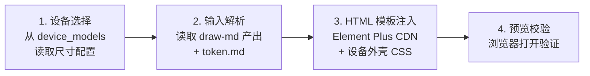

# preview 子命令 —— 使用 Element Plus 实时预览验证

> 本文件是 `preview` 子命令的完整流程,由顶层 [`SKILL.md`](../../SKILL.md) 路由进入。
> 输入 = `draw-md` 产出的页面级 UI markdown(`examples/ui-markdown/` 下),输出 = 自包含 HTML 预览文件。
> 预览使用 Element Plus 框架(CDN 引入),支持设备外壳展示(从 `scripts/device_models.py` 读取尺寸)。

---

## 流程概览



> **CHECKPOINT 与无人值守**:用户说「你定 / 直接做」或会话无人值守时,本文件各处 CHECKPOINT 不逐点阻塞——按 [`SKILL.md`](../../SKILL.md)「无人值守与 CHECKPOINT 降级」节的默认取值表取值,自选决定与理由写入设计说明;看不了图时写明未验证实际视觉,不给视觉打分;没有可运行环境时不说交互已通过。

---

## 1. 设备选择

从 [`scripts/device_models.py`](../../scripts/device_models.py) 读取设备尺寸配置,让用户选择预览设备(设备清单见该脚本,流程文档不重复列出,避免与脚本脱节)。

**🔴 CHECKPOINT · 设备选择**:展示设备列表,让用户选择预览设备。默认选 iPhone 15(393×852)。

---

## 2. 输入解析

读取 `draw-md` 产出的页面 markdown:

1. **解析 frontmatter** — 提取 `name`、`description`、`background`、`updated`、`version`
2. **解析 token.md** — 读取 `examples/ui-markdown/token.md`,建立 token 名→硬值映射表
3. **解析布局章节** — 按"顶部导航 → 主体区块 → 底部 dock"顺序,逐章提取组件类型与参数表
4. **解析 organisms** — 若页面引用了 `organisms/` 下的组件,读取对应 markdown

**🔴 CHECKPOINT · 输入解析确认**:确认 UI markdown + token.md 已读取,设备尺寸已从 device_models.py 选定,展示预览配置摘要(页面名 + 设备名 + 尺寸)供用户确认,再进入 HTML 生成。

---

## 3. HTML 模板注入

将解析结果注入 HTML 模板,生成自包含预览文件:

```html
<!-- SRI 提示:integrity 哈希随 CDN 资源版本变化。当前哈希对应 element-plus@2.4.4 与 vue@3.4.21;更新版本时必须用 `openssl dgst -sha384 -binary <file> | openssl base64 -A` 重新生成并替换 integrity 属性值,否则浏览器会因 SRI 不匹配拒绝加载资源导致预览无法渲染。 -->
<!DOCTYPE html>
<html lang="zh-CN">
<head>
  <meta charset="UTF-8">
  <title>预览 - <页面名称></title>
  <link rel="stylesheet" href="https://unpkg.com/element-plus@2.4.4/dist/index.css"
        integrity="sha384-kkb0OalbI4Ig9NU9d8J+OvUzucgmMGl8jmxwJ2nEw/vqiyQbd0rplhuU5TfnNNYp"
        crossorigin="anonymous">
  <script src="https://unpkg.com/vue@3.4.21/dist/vue.global.js"
          integrity="sha384-8CdW77YPqMZ3v22pThUIR22Qp1FB5oisZG2WE3OpE0l1fTHAIsdIwjQZFf/rmQ/B"
          crossorigin="anonymous"></script>
  <script src="https://unpkg.com/element-plus@2.4.4/dist/index.full.min.js"
          integrity="sha384-BN4M9h5H6vfLYw9pv5Lgjk5VHdDVkm1zzsgkZ1DhGfWie/dDmCsQDVCA728TX0ry"
          crossorigin="anonymous"></script>
  <style>
    :root { /* CSS 变量注入(从 token.md 解析) */
      --color-primary: #...;  --color-surface: #...;
      --font-size-md: 16px;  --spacing-md: 16px;  --radius-md: 8px;
    }
    .device-shell { width: <设备宽度>px; height: <设备高度>px; /* 设备外壳样式 */ }
  </style>
</head>
<body>
  <div id="app">
    <div class="device-shell">
      <div class="device-screen">
        <el-container>
          <el-header><!-- 顶部导航 --></el-header>
          <el-main><!-- 主体区块 --></el-main>
          <el-footer><!-- 底部 dock --></el-footer>
        </el-container>
      </div>
    </div>
  </div>
  <script>
    const { createApp } = Vue;
    const app = createApp({ /* 页面数据与方法 */ });
    app.use(ElementPlus);
    app.mount('#app');
  </script>
</body>
</html>
```

### 设备外壳 CSS

根据设备类型(phone / tablet)选择不同的外壳模板。两者共享 `--el-device-*` CSS 变量命名空间(对齐 Element Plus `--el-*` 规范),采用钛金属渐变边框 + 多层阴影模拟真实设备外观:

- **手机**(phone,iPhone 15 风格):钛金属 5-stop 渐变边框 + Dynamic Island(126×37px 胶囊) + 真实按键布局(静音键/音量上下/电源键) + Home Indicator(134×5px) + 6 层阴影,参考 [`scripts/devices/phone.html`](../../scripts/devices/phone.html)
- **平板**(tablet,iPad Pro 风格):钛金属渐变边框(更薄 7px) + 前置摄像头圆点(带镜头反光) + 音量上下 + 电源键 + 四扬声器栅格 + 6 层阴影 + 动态 scale transform,参考 [`scripts/devices/tablet.html`](../../scripts/devices/tablet.html)

**`--el-device-*` 变量命名空间**(preview 子命令注入 token 时优先映射):

| 变量类别 | 示例变量 | 用途 |
| -------- | -------- | ---- |
| 钛金属色板 | `--el-device-titanium-light/mid/dark` | 边框渐变 5-stop |
| 边框/屏幕 | `--el-device-bezel` / `--el-device-screen-bg` | 黑边过渡 + 屏幕底色 |
| 装饰元素 | `--el-device-notch-bg` / `--el-device-camera-bg` / `--el-device-speaker-bg` | Dynamic Island / 摄像头 / 扬声器 |
| 按键 | `--el-device-button-bg` | 侧边按键渐变 |
| 阴影 | `--el-device-shadow-ambient/key/inner` | 6 层阴影分层 |

### 组件映射规则

| draw-md 逻辑组件 | Element Plus 预览组件 |
| ------------------- | --------------------- |
| button | `<el-button>` |
| text | `<el-text>` / `<p>` / `<h1>`~`<h6>` |
| list | `<el-table>` 或 `<div v-for>` |
| navigation bar | `<el-menu>` / `<el-header>` |
| dock | `<el-footer>` + `<el-button-group>` |

**🔴 CHECKPOINT · HTML 生成确认**:确认 preview HTML 已生成且 token 引用正确(无硬编码颜色/字号/间距),设备外壳 CSS 已注入,提示用户在浏览器打开验证效果。

---

## 4. 预览校验

生成 HTML 文件后,执行校验:

- [ ] HTML 文件自包含(无本地依赖,CDN 资源可访问)
- [ ] CSS 变量已从 token.md 注入到 `:root`,无 `{token-name}` 占位符残留
- [ ] 设备外壳尺寸与所选设备一致(宽×高)
- [ ] 页面内容按 draw-md 章节顺序排列(顶部导航 → 主体 → 底部 dock)
- [ ] Element Plus 组件正确渲染(无 Vue 控制台错误)
- [ ] 在浏览器中打开文件,视觉与 draw-md 描述一致

### 校验强化

preview 产出的 HTML 必须通过 `validate-draw-md.py` 全部 15 项检查(含 8 项新检查:暗色/aria/触控区/动效/radius/z-index/固定宽度文本容器/非逻辑属性),不通过则回退 draw-md 修补。

**状态态对比度门(G31,CRITICAL)**:对每个交互元素取 default / hover / focus **三态的真实计算样式**——沿祖先链回溯有效背景(透明则取父背景),阈值按元素性质:无直接文字节点的图形控件 3:1;文本按字号 / 字重取 4.5:1 或 3:1(≥ 24px,或 ≥ 18.66px 且 bold);native checkbox/radio/switch 与 disabled / opacity:0 按 WCAG 1.4.3 / 1.4.11 豁免。执行:`python3 scripts/verify-states.py <preview.html>`;**无浏览器时显式降级 UNMEASURED(退出码 2),不得记为通过**(三态语义见 [`EXIT-CODES.md`](../../scripts/EXIT-CODES.md))。

**交互真实性门(G32/G33)**:执行 `python3 scripts/verify-interactive.py <preview.html>`,每次点击在**新加载页面**上进行。三信号——A:声明了状态契约(`aria-pressed` / `expanded` / `checked` / `selected` / `sort`,或 switch / tab / menuitemcheckbox / menuitemradio / option 角色)的已启用可见控件,真实点击后文档内无任何变化 → **失败**;B:无状态契约的普通按钮点击无效果 → **仅 advisory**(静态演示按钮是合法形态,不算失败);C:状态属性翻转了,但控件自身计算样式 / 文本 / 几何完全一致(invisible state,读屏听得见、眼睛看不见)→ **失败**。控件上的 `data-demo-state` 是作者手写的「这是状态渲染、不是活控件」声明,按豁免处理。

**AI 味确定性扫描**:自包含 HTML 生成后,对产物运行 `python3 {SKILL_DIR}/scripts/detect-tells.py <preview.html>`(确定性正则检测器,只收可机械判定的 tell 子集,来源:impeccable hooks 思想,2026-09 吸收)。命中非豁免 tell = 硬性失败;豁免沿用 [`../meta/ai-tells.md`](../meta/ai-tells.md) 的「三豁免 + tell-exempt 标注」机制。扫描结果与人工自查(第 6 节)互为通道,合并时按下方「双通道不变式」标注。

**aria-label 在 HTML 的映射规则:**
- button → `<el-button aria-label="语义描述">`
- icon → `<el-icon aria-label="语义描述">`
- input → `<el-input aria-label="语义描述">`
- link → `<a aria-label="语义描述">`

**暗色模式在 HTML 的映射:**
- 用 CSS 变量 + `prefers-color-scheme: dark` 媒体查询
- `{surface-dark}` → `--surface-dark: #1A1B1E;`

### 运行时实测探针(只读取证)

静态扫描看不到真实渲染结果。把页面内探针 [`scripts/preview-lint.js`](../../scripts/preview-lint.js) 注入 preview 的**临时副本**运行,经宿主浏览器工具取回报告;探针**只读取证**——只采样计算样式 / 几何 / 动画事件,**不改页面样式**,与「禁止用开发者工具手动改样式代替预览验证」的禁令(约束汇总)同源:探针发现的问题回产物源修复,不得就地图改。来源:oil-ui(#2/#4),2026-10 吸收。

**可量测问题 14 类**(只报不拦,按处置分级处理):

| 类别 | 机械判据(摘要) |
| ---- | -------------- |
| 眉标 | 紧贴 h1-h3 上方、≤ 16px 且 ≤ 标题 0.6 倍,且大写 / 字距 ≥ 0.05em / 等宽 / 胶囊形态之一 |
| 编号标签 | 正则 `/^0\d$/` 或 `/^(?:0?\d{1,2}\|[IVX]{1,4})(?:\s*[\/·—–\|]\s*\|[.:]\s+)\S/` |
| 彩色单侧边线 | 结构分隔线不算;含 `::before` / `::after`,absolute、宽 2-8px、色度 ≥ 0.15 |
| 渐变文字 | `background-clip: text` + 渐变 + 有文字 |
| 卡片套卡 | 外层圆角块含 border / shadow / 填充;排除弹层跨出 DOM 父级、带删除控件的紧凑编辑器、`[role=listbox\|menu\|dialog\|tooltip][popover]` |
| emoji 当图标 | 按钮内容等同 emoji 或紧跟计数,全页 ≥ 2 处 |
| 中文界面英文大写标签 | 无中文、全大写、≥ 2 处 |
| 对比度 | 正文 4.5:1 / 大字 3:1;低于 1.5:1 不报(多半背后还有查不到的层) |
| 有色底灰字 | 高色度底 + 近中性文字 |
| 正文 < 13px | 两行以上段落 |
| 行高过紧 | 行高 / 字号 < 1.4(中文)/ 1.3(西文) |
| 行过长 | 中文 > 46 字 / 行,西文 > 95 字符 / 行 |
| 首屏停在透明状态 | 首屏内容 opacity 累积 < 0.05 且非定位装饰(出场动画没触发) |
| 标题离上文比离下文近 | 标题属于它后面的内容 |

- 颜色统一画到 canvas 再读回,oklch / color-mix 这类写法也能比较;
- **处置三档**:要改的可读性问题(对比度不达标 / 正文 < 13px / 行高过紧 / 首屏透明)必须修复;「改掉或写出理由」档(有色底灰字、行过长、眉标与编号标签、单侧边线、渐变文字、卡片套卡、emoji 图标、英文大写标签、标题间距)改掉或在交付说明写出它怎样服务方向;保留项写进交付说明;
- 检查会误报(真实的步骤编号、确实需要的标签):误报在交付说明写一句,不为过检查改业务代码(接口 401/404 等记一行即可);
- **探针只认得写法,判断不了好不好看**:提示清零之后,仍要自己看截图。

**动效探针(同一资产、同一注入点,注入早于页面脚本)**:

- **四相位采样**:首次进入 / `--steps` 动作步骤 / 首屏滚动 / 从头滚到底;
- `animationstart` / `transitionrun` 捕获监听 + MutationObserver(只订阅 style / transform / viewBox / d / x / y / cx / cy / r / points / opacity / stroke-dashoffset 等)+ rAF 逐帧;识别 ScrollTimeline / ViewTimeline;
- 首屏相位按视口坐标量(固定舞台不算「在动」,舞台里的层次变化才算);
- `frames < 3` 跳过——一次性跳变是状态写入,不是动效;
- **弱动效判定**:`maxMove < 4 && maxSize < 0.02 && maxOpacity < 0.3`;
- **三条结论文案**(逐字):「没有检测到动画 / 只有持续循环的动画,没有一次性的出场或反馈 / 动画幅度太小,看不出来」;
- 首屏景深**只报层数与幅度,不记问题**(是可选手法);页面不滚动时滚动相跳过;
- **滚动叙事不是硬性要求**——落地页 / 品牌页 / 发布页 / 展览页「需要一段滚动叙事」只是提示,maliang 现状滚动叙事为可选模式,不得写成 hard fail。

### 取证契约(截图纪律)

> 来源:oil-ui(#5),2026-10 吸收。截图只有两种用途,不要混在一起,也不要把「看一眼」当证据。

**用途分流**:「看一眼」只截当前这一屏(一批改动攒完再截,页面没变不重复截);「取证」一次取齐——状态图 / 2x 图 / 并排图 / 遮字图 / 动效探测 / 录屏六类,**只在送评审前与交付前**做,由 [`scripts/evidence-check.py`](../../scripts/evidence-check.py) 按 report.json 校验齐套:缺项逐条列清单并把相关结论推 `unverified`。取证记录按元素结构存 `{file, meta, animationWaitMs, issues, lint}`。

- **每轮只重取受影响的证据**:没动过的状态与动效沿用上一轮文件,交接时注明哪些是沿用的;拿不准是否受影响(如改了共享样式)就重取那一项;
- **静止终态以截图为准**:汇总提示录屏与截图不一致时,以终态截图为准,单独重录那一段核对过渡;**空 WebGL 截图不当证据**;
- **单项失败记进报告后继续**:单项超时 → 重开浏览器重试一次;不得因单项失败吞掉整轮结果,仅失败置退出码 1;
- **跨轮比较条件指纹**:说「改善了 / 退步了 / 趋势向好」之前,先核对两轮评估条件(评估页集与分母 / 设备与视口 / 字号与内容 / 模式)逐字段一致,不一致**拒绝比较并重建基线**;每轮证据用新目录,拒绝覆盖旧轮(G34)。

**截图纪律**:

1. **截图前**:等页面 settle(字体 / 图片 / 异步渲染完成),**禁用入场动效**(或等其播完)再截——动画时序藏住的元素会被误判为缺失,导致错误返工;
2. **截图范围**:整页从文档顶部开始截(而非视口内裁剪),按设备外壳自身尺寸截;
3. **截后逐一开文件验证**:打开每个截图文件核对"文件名与内容相符"(无黑块 / 空区 / 错节)。**畸形截图送审 = 整轮作废**(disposition: recapture),重截后再进入评审。

**验证两轮封顶**:发现 → 修复 → 复验的循环最多两轮;两轮后仍有发现,升级 disposition(`fix` → `rebuild`)而非开启第三轮——开放式自检烧钱且收敛差。

**双通道不变式**:LLM 自查(第 6 节)与确定性检测(`preview-check.py`)是两条通道——**先完成自查、再读检测结果**(检测输出是确定性的,但仍会锚定判断);两边结果合并时,每条发现必须标注通道(`[自查]` / `[脚本]` / `[双方]`)。

### 证据四分类(产物报告必填字段)

> 来源:frontend-design-practicalswan + mobile-native,2026-09 吸收。
> 每项校验/验证结论必须标注以下四类证据之一;**禁止从单一分数声称合规**——"5 维 15 分"或"140 项全过"不构成证据,证据是"凭什么知道"。

| 类别 | 含义 | 合格证据形态 |
| ---- | ---- | ------------ |
| `automated` | 脚本 / 工具跑出 | `preview-check.py` / `validate-draw-md.py` 输出摘要(含命令与参数) |
| `measured` | 量测数值 | CWV 指标 / 对比度比值 / 触控目标尺寸,附数值 + 测量工具与环境 |
| `manual` | 人工实测 | 浏览器 / 真机逐项确认,注明设备型号、系统、浏览器与网络环境 |
| `unverified` | 未验证 | 显式列出未验证项与原因,禁止默认通过、禁止留空 |

- "看起来没问题"不是 `manual`;四类之外的说法不算证据;
- `unverified` 非空时 disposition 不得为 `deliver`(只能 `fix` / `blocked`);
- 与双通道不变式互补:通道标注**谁发现了问题**,证据分类标注**凭什么断言已解决**。

**证据须带产物哈希(哈希变了证据作废)**——来源:ux-ui-agent-skills(#17)+ styleseed(#19),2026-10 吸收:

- `automated` / `measured` 证据附**活收据**:门禁名 / 被测文件路径 + **测量前**取的 SHA-256(哈希记录的就是数字所描述的那个状态)/ 退出码 / 关键数字 / 时间戳,由 [`scripts/receipts.py`](../../scripts/receipts.py) 记录与查询;
- `--check` 三态:**OK** / **EXPIRED**(「was measured, then edited」——被测文件在测量后被编辑,旧证据作废,须重跑)/ **UNMEASURED**(没有测量记录,**不是通过**);
- 上一会话的收据**永不复用**;写不出收据 = 当作**未记录**;「已解决」结论只能由重算证据推导,不能由声称推导(不得用「--status pass」式自述)。

**证据等级(可重算优先)**:自述(不算证据)< `manual` < `measured` / `automated` < **可重算**(附活收据、哈希仍匹配)。等级只升不降:同一条结论在新一轮里证据等级降低(如可重算 → manual)时视为回退,须说明原因。

### 收尾前未测量清单(会话纪律)

本次会话**改过**的可渲染产物(预览 HTML / 组件代码 / 样式),收尾前逐项对收据——**没有活收据 = 未测量**。来源:ux-ui-agent-skills(#18),2026-10 吸收。

1. 收尾回复必须**显式列出未测量项与原因**,不得以「已通过 / 应该没问题」措辞收尾;
2. 无浏览器(探针与三态门跑不了)时允许结束,但回答必须写明 **UNMEASURED**(不是通过),并给出补测路径;
3. 有活收据的项照常写通过;收据 EXPIRED 的项先重跑门禁再写结论。

> **hooks 说明**:平台 hooks(编辑后自动快检 / 收尾拦截未测量项)是**可选增强**——本轮不实现,`hooks.json` 属插件全局行为,启用与否由用户决定;本清单动作是平台无关的 canonical 做法,有 hooks 的平台将来可自动执行同一清单。

---

## 5. Pre-Flight Check(140 项机械检查)

> 交付前**机械扫描**(可脚本化,非主观判断)。任一项失败即"硬性失败",不可交付,必须返工。来源:taste-skill + ui-ux-pro-max-skill。

**完整 140 项检查清单见 [`preview-checklist.md`](./preview-checklist.md)**(从本文件拆出以控制行数),按 17 个分组:

| 分组       | 项数 | 覆盖范围                                                  |
| ---------- | ---- | --------------------------------------------------------- |
| 5.0 Process 动态实测 | 7    | 375px/横屏旋转/reduced-motion/200% 字号/暗色对比/长内容与本地化膨胀/慢与失败依赖(先于全部分区) |
| 5.1 AI Tells | 15   | 渐变/圆角/字族/容器宽度/定价/Lucide 等通用 AI 味         |
| 5.2 Performance | 10   | 图片尺寸/字体/动画属性/z-index/JS 体积/虚拟滚动           |
| 5.3 WCAG 对比度 | 8    | 正文/大文本/UI 组件/placeholder/暗色模式/色盲             |
| 5.4 用户偏好 | 6    | reduced-motion/reduced-transparency/双跑预览              |
| 5.5 交互可达 | 8    | Tab/focus ring/触摸目标/alt/aria-label/Skip 链接          |
| 5.6 Token 完整性 | 12   | CSS 变量/硬编码/三层引用/kebab-case/孤儿类选择器/未定义 var |
| 5.7 完整交互状态 | 11   | 五态/Loading/Empty/Error/Tactile/toast/同义 CTA 去重/按钮折行/动词一致 |
| 5.8 LLM 截断信号 | 8    | 章节字数/代码块完整/placeholder/文案具体性                |
| 5.9 动画动机 | 8    | 动机可答/装饰循环/duration/stagger/translateY/缓动/动效四相位探针 |
| 5.10 排版细节 | 7    | **em-dash 中文场景**/eyebrow 计数/标题字数/中英空格/盘古之白/标点 |
| 5.11 视觉一致性锁 | 8    | **主题锁/色彩锁/形状锁/原生面锁**/阴影档位/字号档位        |
| 5.12 Hero 适配 | 6    | 移动端/桌面端 Hero/100svh/srcset/poster/CTA 数            |
| 5.13 Core Web Vitals | 5    | **LCP/CLS/INP/FCP/TBT** 阈值                              |
| 5.14 交付完备性 | 7    | 法务链接/返回导航/404/表单校验/skip-link/favicon/数据页诚实性 |
| 5.15 真机验证 | 8    | 粘滞 hover/tap 高亮/URL 栏视口/聚焦缩放/overscroll/safe-area/软键盘/PWA standalone(全部需真机) |
| 5.16 生产化加固 | 6    | 极端输入/错误分状态/并发防重/i18n 三判据/中断手势恢复/verify 清单(见 hardening.md) |

### 执行规则
- 140 项均为**机械检查**(可脚本化或运行时实测,非主观判断),任一项失败 = 硬性失败(不可降级为 warning;末尾列明的四项软警告除外;标记 `[运行时·探针]` 的项按探针三档处置,见第 4 节),失败项必须列出具体位置(HTML 行号 / CSS 选择器)
- 51 项由 [`scripts/preview-check.py`](../../scripts/preview-check.py) 自动执行(含 5.3 WCAG 对比度、5.7 交互状态静态代理、5.6 孤儿类选择器与未定义 var);其余 89 项为**运行时项**(标记 [运行时],见 checklist),在第 4 节浏览器验证中逐项确认;5.15 真机验证项在第 4 节之后、交付声明之前按 checklist 调试路径实测
- 修复后重跑全部 140 项(不可只跑失败项),通过后先过**编号门禁**(见下),再进入第 6 节 Pre-Delivery Checklist(主观维度)
- em-dash / 中英文空格 / 盘古之白 / 标点一致性为**软警告**(warning),其余 136 项为硬性失败

### 编号门禁(140 项之外的否决层)

> 140 项回答「该项过没过」,编号门禁回答「**这种形态不许交**」。两处都过才算过(规则 canonical 见 [`../meta/numbered-gates.md`](../meta/numbered-gates.md) §0)。

过 140 项之后、第 6 节之前,逐条过 [`../meta/numbered-gates.md`](../meta/numbered-gates.md) 的 **G01–G38**(A 溯源与 token / B 可访问性与触控 / C 视觉签名 / D 交互与状态 / E 布局与响应 / F 交付与可核验性 / G 定义层成立性)。执行纪律:

- **全量过,不摘要**——把门禁压缩成「主要几条」等于丢门,门禁的价值正在于覆盖了没被想到的形态
- **有据才判**——「源码里没看到违反」必须附判定记录(命中行号清单 / 检查点结论),缺证据视为未判定;token 溯源三项由 [`scripts/validate-design-md.py`](../../scripts/validate-design-md.py) 机械判定并留 [`../meta/token-provenance.md`](../meta/token-provenance.md) §5 的三行核对,人工仅复核脚本标 unconfirmed 的项
- **不豁免不降级**——唯一合法出路是修复;确属 ai-tells §0 的正当形态时走其显式记录要求,静默豁免 = 失败
- **CRITICAL 一票否决**——B 组任一失败不得被任何评分补偿(见 [`../meta/rules-priority.md`](../meta/rules-priority.md) 冲突裁决规则 1 与加权评分从属声明)

### 误报过滤(What is NOT a failure)

机械清单之外,以下情况**不算失败**,不得要求返工:

- **有动机的大胆选择正确运作**——饱和配色、戏剧化字阶、非对称布局,只要能在 DESIGN.md 找到对应承诺,是特色不是缺陷("Distinctive is the goal");
- **DESIGN.md 已显式批准的选择**——进了设计系统的值是决定,不是 slop;清理时不得把系统批准值"修正"回惯例默认;
- **运行时项的静态不可判**——渐变/透明背景对比度、CDN 框架默认态样式等静态无法解析的组合,脚本跳过不猜测,留待浏览器验证,不作为失败项;
- **范围外**:diff/产物之外的既有代码、linter/formatter 管辖的格式问题。

宁要 3 个高信念发现,不要 40 条 cosmetic 清单;说不出"让用户付出什么代价"的发现一律删除。

---

## 6. Pre-Delivery Checklist(5 维交付前检查)

> Pre-Flight Check(140 项)与编号门禁(G01–G38)**双双通过后**的**主观维度评审**。5 个维度,每维度 1-5 分,任一维度 < 3 分不交付。来源:taste-skill。
> 评审必须与生成**隔离执行**(见下方"评审隔离"),评审者输出以受限词表 disposition 开头。

### 评审隔离(审查与生成分离)

生成产物的同一上下文既当运动员又当裁判,会系统性高估自己的产出。因此:

1. **优先用独立评审者**:通过 Task/subagent 工具派生一个**新的评审代理**,只提供交付物(preview HTML / 截图 / UI markdown / DESIGN.md 摘要)与本文评分标准,**不携带生成过程的自我评估**。评审者没有"这是我刚写的"的注意力偏向。
2. **无法派生代理时显式降级**:在评审报告首行标注 `⚠️ DEGRADED: self-review(无 subagent 可用)`,评分从紧(每维 -1 分后仍需达标才可交付)。静默自评 = 评审失败。
3. **评审者输出契约**(每个发现都要三件事,禁止表扬性总结):
   - **什么被默认了**(而非"哪里不好");
   - **为什么读作通用/让用户付出代价**——说不出代价的意见是口味,删除;
   - **具体的 crafted 修法**(给决定,不给补丁)。
4. **报告首行 = disposition,受限词表,四选一**:
   - `deliver` — 5 维全部达标,直接交付
   - `fix` — 有可修发现,列出清单返回 draw-md 修补后复审
   - `rebuild` — 组合性缺陷(无焦点/扁平层级等),单点修补无意义,重走 draw-md
   - `blocked` — 证据不足(无法渲染/产物缺失),禁止在坏证据上给结论

### 维度 1 · Completeness(完整性)
- 设计是否覆盖所有页面章节?
- 组件是否覆盖 default + 状态变体?
- DESIGN.md 引用的 token 是否全部出现在产物中?
- 是否有"待补全"占位?

### 维度 2 · Correctness(正确性)
- 颜色对比度是否真的达标(不仅 Pre-Flight 项通过,实际场景也合理)?
- 间距是否符合 8px 网格(或 DESIGN.md 声明的 base)?
- 字体是否正确加载(无 fallback 到 system-ui)?
- 交互逻辑是否无矛盾(如 disabled 按钮可点击)?

### 维度 3 · Consistency(一致性)
- 跨页面间距 / 圆角 / 字号档位是否一致?
- 同类组件(如多个卡片)样式是否统一?
- 暗色模式与亮色模式视觉是否对应?
- 文案语气是否一致(同一称呼 / 同一术语)?

### 维度 4 · Brand Fit(品牌契合)
- 是否避免了 AI Tells 的"通用感"?
- 是否符合 [`product-reasoning.md`](../meta/product-reasoning.md) 推理的产品类型?
- 是否参考了 [`design-systems.md`](../dimensions/design-systems.md) 中的 1-2 个锚点?
- 视觉是否与品牌色 / 品牌字体一致?

### 维度 5 · Polish(完成度)
- 微动效是否丝滑(无闪烁 / 无跳帧)?
- 边界场景(空数据 / 长文本 / 错误)是否处理?
- 移动端布局是否真的可用(非仅"响应式")?
- 视觉细节(对齐 / 字距 / 阴影)是否到位?

### 决定性自检(Decide-or-Default)

5 维评分前,评审者先回答两个可判定问题——**"每个值是被决定的,还是默认的?"**:

- **Swap test**:把主字体换成通常默认字体、布局换成标准三段模板,渲染结果会明显不同吗?感觉不到差异的区域 = 该区域在默认,不是在设计。
- **Signature test**:指出本页 ≥ 3 个签名元素(只属于这个产品的具体选择)及其位置。"整体有感觉"不算——指不出具体位置就是没有签名。
- **Squint test**:眯眼(或缩小 / 模糊渲染)看整页,层级仍然可读吗?眯眼后焦点仍最先被看到、无刺眼噪声 = 通过;一片灰、焦点消失 = 层级靠细读才成立,失败。

任一自检失败,Brand Fit 维度不得高于 2 分。

### 评分规则

通用锚点(每维共用):

| 分 | 锚点 |
| --- | --- |
| 5 | 优秀参考案例——可直接进设计系统做范例 |
| 4 | 良好可交付——有可见的小瑕疵,不影响使用与认知 |
| 3 | 及格——有可见问题,用户能感知但能容忍 |
| 2 | 不及格——用户会卡住 / 误读 / 明显"AI 味" |
| 1 | 严重不及格——不可用或完全通用,需重新设计 |

各维 ≤ 2 分的客观判据(命中任一即该维 ≤ 2,不可凭整体印象给 3):

| 维度 | ≤ 2 分判据(命中即 ≤ 2) |
| --- | --- |
| Completeness | 存在"待补全"占位;缺 default 态之外的任一状态变体;DESIGN.md 引用 token 未出现在产物 |
| Correctness | 任一 WCAG 对比度实际场景不达标;间距脱离 DESIGN.md 声明的网格;字体 fallback 到 system-ui |
| Consistency | 同类组件(≥ 2 个卡片/按钮)样式不一致;暗色亮色结构不对应;同页同一术语两种称呼 |
| Brand Fit | swap / signature / squint 自检任一失败;命中 [`ai-tells.md`](../meta/ai-tells.md) 任一无豁免 Tell |
| Polish | 空数据/长文本/错误场景未处理;移动端布局不可用;微动效闪烁跳帧 |

**交付阈值**:5 维度全部 ≥ 3 分,且总分 ≥ 15 分。低于阈值不可交付,需返回 draw-md 修改。

**推定阻断项**(任一命中即不可交付,无论总分多高):

| 推定阻断项       | 判定                                                   |
| ---------------- | ------------------------------------------------------ |
| 无焦点样式       | 每屏没有明确的视觉焦点(焦点元素不赢)                 |
| 仅字号做层级     | 层级只靠字号,无字重 / 颜色 / 留白配合                 |
| 单调布局         | 全页同一节奏(等宽容器 + 等距 section)                 |
| 怯色             | 大面积中性灰,强调色几乎不出现                         |
| 缺交互状态       | 主操作缺 hover / pressed / focused / disabled 任一态   |
| 结构性 hack      | 负 margin 抵消父 padding / 逃生舱 calc() / 绝对定位绕布局流 |
| 不可访问手搓控件 | 自制控件缺键盘导航 / 焦点管理 / ARIA                   |

> 推定阻断项按"镜头"判定而非打分:这些是**组合性失败**,单点修补无意义,命中即 disposition 应为 `rebuild`(而非 `fix`)。说得出 DESIGN.md 显式批准依据的 bold 选择不算阻断(见第 5 节误报过滤)。

**🔴 CHECKPOINT · 交付确认**:评审报告首行输出 disposition(deliver / fix / rebuild / blocked,见"评审隔离"),附 5 维评分 + 总分,与用户确认后交付。`fix`/`rebuild` 时明确列出"需修复:[清单]"写入下一轮 draw-md 输入。

### 回传协议(用户选择回传)

预览页里的选择与确认要可靠回传当前会话,不靠用户复述。来源:qiaomu-design(#25),2026-10 吸收。

- **本地回传桥**:`python3 scripts/preview-server.py <预览目录>` 起 127.0.0.1 本地服务(自动选端口、自动开浏览器、幂等注入选择外壳);用户**在确认弹层确认后**才写 `selection.json`,并向 stdout 打印哨兵 `MALIANG_DESIGN_SELECTION::{...}`;带 `--exit-on-select` 时确认后服务退出;
- **读取方式**:watcher 文件事件优先,短轮询并发兜底(不作为默认路径);未见回传证据前调用方不得结束回合;
- **禁止**:倒计时 / 超时默认 / 推荐态自动写入 `selection.json`;把页面上的推荐态当作用户选择;
- **降级路径**:服务不可用时退回 `file://` + 页面高亮 + 剪贴板复制「选 X」文本,并**明说「当前不会自动回传,请在对话里回复选择」**;
- **进入下游 / 认定「用户已选」 = 三选一证据**:已观察到 selection.json / 已见 stdout 哨兵 / 对话中明确选择(或明确授权默认推荐方向)。三选一之外一律视为**未选择**。

---

## 产出物
- 一个页面 → 一个 HTML 预览文件
- 文件命名:`preview_<page-name>_<device>.html`(如 `preview_home_iphone15.html`)
- 产出位置:用户指定目录(默认 `examples/preview/`)

---

## 约束汇总(硬性)

- [ ] 产出 HTML MUST 为自包含文件(CDN 引入 Element Plus,无本地构建依赖)
- [ ] 设备尺寸 MUST 从 `scripts/device_models.py` 读取,MUST NOT 硬编码在流程文档中
- [ ] 设备外壳 MUST 用纯 CSS 绘制(圆角 + 刘海 + 边框),MUST NOT 依赖图片资源
- [ ] Token 引用 MUST 解析为 CSS 变量值,MUST NOT 在产出 HTML 中残留 `{token-name}` 占位符
- [ ] 预览文件 MUST 可直接用浏览器打开(file:// 协议),MUST NOT 需要本地服务器
- [ ] 禁止用浏览器开发者工具手动改样式代替预览验证(无法复现、不入产物)
- [ ] 运行时探针 MUST 只读取证(注入脚本只采样计算样式 / 几何 / 动画事件),MUST NOT 改写页面样式——发现的问题回产物源修复,与上一禁令同源
- [ ] 本次会话改过且无活收据的可渲染产物,MUST 在收尾回复显式列为未测量项;无浏览器时 MUST 写明 UNMEASURED,禁止以「已通过」措辞收尾(见「收尾前未测量清单」)
- [ ] 禁止跳过 iOS/Android 双端验证(单端通过不代表另一端布局/字体一致)
- [ ] 禁止预览问题只口头记录不写入修复清单(MUST 输出到下一轮 `draw-md` 的输入)
- [ ] 禁止用模拟器截图代替真机预览(关键页面 MUST 真机验证,模拟器仅用于布局快速校验)

---

## 失败模式与 fallback

| 触发条件 | 处理方式(一线修复 → 仍失败兜底) |
| -------- | ---------------------------------------- |
| 设备尺寸不在 scripts/device_models.py | 提示用户从已支持设备选最接近的 → 用最接近尺寸替代,标注"近似尺寸" |
| Element Plus CDN 不可达(离线) | 提示检查网络 → 引导用户下载 Element Plus 本地引用 |
| file:// 协议下 CDN 被阻断(混合内容策略) | 提示改用 http(s):// 或本地服务器 → 或下载 CDN 资源到本地引用(注:与"file:// 可打开"约束存在权衡,需用户选择) |
| UI markdown 缺少 token 引用(裸值) | 提示具体偏差(哪些值未引用 token) → 用 DESIGN.md token 替换,标注"自动补全,需确认" |
| preview HTML 浏览器渲染异常 | 提示检查控制台错误 → 引导用户简化 UI markdown(移除复杂组件)后重试 |
| 探针注入失败 / 宿主无浏览器工具 | 对应项记 **UNMEASURED**(不得记为通过) → 人工可判项按截图走查补,报告写明未测量项与原因 |
| 回传桥端口被占 / 无法启动 | 提示换端口或换目录 → 降级 file:// + 剪贴板,并明说「当前不会自动回传,请在对话里回复选择」 |
