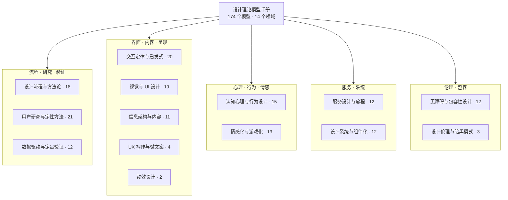

# 设计理论模型参考手册

> 规范层(详尽层)。174 个设计理论模型的全量明细(定义/何时用),供 [`theory-router.md`](theory-router.md) 按锚点引用——**不要整篇加载**:先经路由层判段选模型,再查对应领域章节的条目行。与 [`ux-laws.md`](ux-laws.md) 的分工:常用定律的机制与 UI 含义以 ux-laws 为 canonical,本文收全量条目。

本手册收录 174 个设计理论模型，划分为 14 个领域：设计流程与方法论、交互定律与启发式、视觉与 UI 设计、认知心理与行为设计、用户研究与定性方法、信息架构与内容、情感化与游戏化、设计系统与组件化、服务设计与旅程、无障碍与包容性设计、数据驱动与定量验证、设计伦理与暗黑模式、UX 写作与微文案、动效设计。条目历史上由上游源清单按原文收录并经审读修订补充公认地标模型，曾共收录 186 条；剔除 12 条商业/战略/管理类框架，原「产品与商业决策」领域仅保留用户故事地图并迁入设计流程与方法论。使用方式：先看「领域分组」与「领域总览」定位领域，再进入对应章节查阅模型表格；每张表按「中文名｜英文名｜定义｜何时用」四列组织。少量模型在多个领域各有一条（用户画像、福格行为模型、Hooked 上瘾模型、HEART 框架），另有 3 组同源条目对，

## 领域分组

14 个领域按性质归入五个族：流程与研究、界面与呈现、心理与情感、服务与系统、伦理与包容。族是导航用的归簇，不是新的领域划分；完整条目见后续各领域章节。

## 领域总览

按领域统计如下；代表模型仅作索引用，完整条目见各领域章节。

| 领域 | 模型数 | 代表模型 |
| --- | --- | --- |
| 设计流程与方法论 | 18 | 双钻模型、设计思维、设计冲刺 |
| 交互定律与启发式 | 20 | 菲茨定律、希克定律、尼尔森十大可用性启发式 |
| 视觉与 UI 设计 | 19 | 格式塔感知组织原理、栅格系统、响应式设计 |
| 认知心理与行为设计 | 15 | 认知负荷理论、损失厌恶（前景理论）、助推理论 |
| 用户研究与定性方法 | 21 | 用户访谈、待办任务理论（JTBD）、出声思维法 |
| 信息架构与内容 | 11 | UX 蜂窝模型、信息架构四系统、分面分类 |
| 情感化与游戏化 | 13 | 情感化设计三层次、八角行为分析框架、自我决定理论 |
| 设计系统与组件化 | 12 | 原子设计、设计令牌、Material Design |
| 服务设计与旅程 | 12 | 服务蓝图、用户体验地图（客户旅程地图）、关键时刻 |
| 无障碍与包容性设计 | 12 | WCAG 与 POUR 四原则、通用设计七原则、微软包容性设计三原则 |
| 数据驱动与定量验证 | 12 | A/B 测试、眼动追踪、系统可用性量表（SUS） |
| 设计伦理与暗黑模式 | 3 | 暗黑模式、价值敏感设计、隐私设计七原则 |
| UX 写作与微文案 | 4 | 微文案、简明语言、内容设计 |
| 动效设计 | 2 | 迪士尼十二动画原则、Material 动效规范 |
| 合计 | 174 | — |

## 1. 设计流程与方法论

覆盖从发现问题到交付方案的端到端流程框架与团队协作方法。

|中文名|英文名|定义|何时用|
|---|---|---|---|
| 双钻模型 | Double Diamond | 把设计过程分为发现、定义、发展、交付四阶段，每阶段先发散再收敛的两次钻石形思维框架。 | 问题空间与方案空间都模糊时，用两次发散收敛保证先找对问题、再找对答案。 |
| 设计思维 | Design Thinking | 以共情理解用户、重新定义问题、发散创意、原型并迭代测试为核心的创新方法论，常用五阶段流程。 | 面对定义不清的复杂问题，需要跨职能团队以人为中心探索创新方案时。 |
| 以用户为中心的设计 | User-Centered Design / Human-Centered Design (UCD/HCD) | 设计与开发全程围绕用户展开：理解使用情境、明确需求、产出方案并按需求评估迭代的人本设计方法。 | 确立设计工作的基本立场，确保每项决策可追溯到真实用户需求而非技术偏好。 |
| 精益 UX | Lean UX | 用假设替代交付物，以最小成本验证设计假设并快速迭代的跨职能协作方式，源自精益创业思想。 | 敏捷开发环境下，需要以试验和证据而非高保真文档驱动设计决策时。 |
| 设计冲刺 | Design Sprint | 五个工作日内通过映射问题、画方案、定决策、做原型并请真实用户测试，回答关键业务问题的时间盒流程。 | 需要在投入开发前，用一周快速验证高风险产品方向或新功能是否可行时。 |
| IBM 企业级设计思维 | IBM Enterprise Design Thinking (The Loop) | 面向企业规模的持续循环「观察—反思—制作」，以 Hills、Playback、赞助用户等实践让大团队始终对齐用户成果。 | 大型组织需要在几十上百个团队间规模化设计实践、保持以用户成果对齐时。 |
| 参与式设计 | Participatory Design | 让受设计影响的人作为平等伙伴直接参与设计过程的共创方法，源于斯堪的纳维亚工会研究传统。 | 设计对象与设计者生活经验差异大，需要用户的专业知识直接进入设计决策时。 |
| 用户体验五要素 | The Elements of User Experience | 把用户体验设计分解为战略、范围、结构、骨架、表现五个层次，自下而上从抽象决策到具体呈现。 | 规划网页或产品时，厘清各层决策顺序，避免跳过战略直接打磨界面。 |
| 情境设计 | Contextual Design | 以情境访谈进入用户真实工作现场，经工作模型、亲和图综合，再到系统设计的全套客户中心设计流程。 | 设计支持复杂工作实践的系统前，需要从真实场景的田野数据推导需求与方案时。 |
| 目标导向设计 | Goal-Directed Design | 从用户目标出发的交互设计流程：研究、建模（人物角色）、定义需求、框架、精化与开发支持。 | 交互设计需要一套从民族志研究到界面方案的端到端方法时。 |
| 用户画像 | Personas | 把用户研究综合成有名字、目标与场景的典型虚构用户，让团队对准具体人物设计而非抽象平均值。 | 需要把分散的研究发现变成团队共享的决策工具、防止为自己设计时。 |
| 双轨敏捷 | Dual-Track Agile | 同一团队并行运行发现与交付两条轨道：发现轨用低成本试验快速验证想法，交付轨构建已验证的想法。 | 敏捷团队只顾交付积压清单、无暇验证想法价值时，用双轨把设计验证嵌入每次迭代。 |
| 用户故事地图 | User Story Mapping | 以用户活动为主干横向铺开故事、纵向切分发布版本，让团队看见全貌再规划 MVP。 | 规划 MVP 范围与发布节奏、避免把用户旅程切碎成孤立需求时。 |
| 头脑风暴法 | Brainstorming | 围绕明确问题的小组创意生成方法，遵循延迟评判、追求数量、欢迎自由奔放、搭便车组合四条规则。 | 项目早期需要快速产出大量备选方案、开拓思路时；为 SCAMPER 等创意工具提供发散素材。 |
| 假设映射 | Assumption Mapping | 把方案假设按风险类别列出，按重要性与不确定性二维排序，优先验证最危险假设。 | 项目启动前：暴露全部押注假设，决定先测什么。 |
| SCAMPER 七问创新法 | SCAMPER | 用替代、合并、调整、修改、他用、消除、重排七类问题系统触发创意的检查清单。 | 迭代现有产品缺思路：按七问逐项变换现有方案。 |
| 创新框架（双钻扩展版） | Framework for Innovation | 双钻 2021 进化版：四阶段外再加以人为本、沟通、协作、迭代四项核心原则。 | 组织级设计流程升级：在双钻上叠加原则与参与方式。 |
| 系统设计框架 | Systemic Design Framework | 双钻的系统级变体：探索、重构、创造、催化四活动配人脉、杠杆、未来等六透镜。 | 应对跨学科复杂系统挑战：超出产品单一双钻的场景。 |

**双钻模型（Double Diamond）流程**

## 2. 交互定律与启发式

描述人类行为规律的心理学定律与界面评估的经验准则，用于预测与诊断交互问题。

|中文名|英文名|定义|何时用|
|---|---|---|---|
| 菲茨定律 | Fitts's Law | 指向目标的时间由到目标的距离与目标尺寸决定：越远越慢，越大越快。 | 确定按钮等操作目标的尺寸、位置与间距，缩短指向时间。 |
| 希克定律 | Hick's Law (Hick-Hyman Law) | 选项越多，决策时间越长，随选项数量的对数增长。 | 精简菜单与选项、拆分复杂决策，降低用户决策负担。 |
| Jakob 定律 | Jakob's Law | 用户大部分时间在别的网站度过，故期望你的网站像熟悉的网站一样运作。 | 遵循业界通用交互惯例；偏离惯例的创新须有充分理由。 |
| 米勒定律 | Miller's Law (7±2) | 工作记忆平均只能同时保持约 7±2 个信息组块。 | 控制导航项与选项数量，用组块化组织信息，减轻记忆负荷。 |
| 特斯勒复杂性守恒定律 | Tesler's Law (Conservation of Complexity) | 每个系统都有不可消除的固有复杂性，只能决定由谁来承担。 | 权衡复杂性在用户与开发者之间的归属，主动简化用户侧。 |
| Postel 定律（健壮性原则） | Postel's Law (Robustness Principle) | 对自己发出的东西保守严谨，对接受的他人输入宽容灵活。 | 设计输入解析与表单容错策略；注意安全场景下的反向约束。 |
| 多赫蒂阈值 | Doherty Threshold | 系统响应低于 400 毫秒，用户效率与投入度显著提升。 | 为响应速度设定性能目标，用加载动效掩盖必要等待。 |
| 尼尔森十大可用性启发式 | Nielsen's 10 Usability Heuristics | 十条基于经验的界面可用性通用准则，用于专家启发式评估。 | 低成本专家评估界面，快速定位可用性问题。 |
| Shneiderman 八条黄金法则 | Shneiderman's Eight Golden Rules | 一致性、快捷方式、明确反馈、对话闭环、防错、可撤销、用户掌控、减轻记忆负荷。 | 作为交互设计的通用检查清单，覆盖对话式界面的核心准则。 |
| Norman 设计原则 | Norman's Design Principles (Affordance, Signifier, Mapping, Feedback, Conceptual Model) | 可供性、意符、映射、反馈与概念模型五项以用户为中心的核心原则。 | 判断用户能否看懂并正确使用界面，诊断误操作根因。 |
| 转向定律 | Accot-Zhai Steering Law | 沿受限路径移动到目标的时间与路径长度成正比、与路径宽度成反比。 | 评估滚动、手势、滑块等轨迹类交互的效率与路径设计。 |
| GOMS 模型（含键击层模型） | GOMS & Keystroke-Level Model (KLM) | 将任务分解为目标、操作、方法、选择规则，预测专家操作时间。 | 无需用户测试即可比较不同交互方案的任务时长。 |
| 执行与评估鸿沟 | Gulf of Execution & Evaluation (Seven Stages of Action) | 用户意图与系统可做之间、系统状态与用户理解之间的两道鸿沟。 | 诊断用户为何无法执行意图或看不懂界面状态。 |
| 信息觅食理论 | Information Foraging Theory | 用户如觅食者循信息线索导航，以最小代价获取最大信息收益。 | 优化链接文案与信息线索，理解站内导航与搜索行为。 |
| 练习幂定律 | Power Law of Practice | 操作时间随练习次数按幂函数下降，用户越用越熟练。 | 权衡易学与熟练后效率，预估用户从新手到熟练的绩效。 |
| 韦伯定律 | Weber's Law | 最小可觉差与原刺激强度成正比，感知取决于变化比例而非绝对量。 | 判断界面改动多大才被察觉：如价格调整与尺寸变化。 |
| 克鲁格第一可用性定律 | Krug's First Law of Usability (Don't Make Me Think) | 好界面应不言自明：用户无需思考即可看懂并使用页面元素。 | 评审界面自我解释性：消除让用户停下来猜的元素。 |
| 奥卡姆剃刀 | Occam's Razor | 若多个解释或方案效果相当，应选择假设最少、元素最少的那个；不必要的复杂性应被剔除。 | 多个设计或解释都能解决问题时，用它倾向更简单的方案，砍掉不必要的元素与功能。 |
| 帕累托法则 | Pareto Principle (80/20 Rule) | 约 80% 的结果来自 20% 的原因；少数功能与内容承载大多数使用价值。 | 功能与内容做优先级取舍、界面做减法时，把资源集中于高频核心的少数部分。 |
| 帕金森定律 | Parkinson's Law | 工作会自动膨胀，直到填满全部可用时间；分配多少时间，任务就耗掉多少时间。 | 为任务、会议与流程设定时间盒与资源上限，防止交互流程与协作环节无限拖长。 |

## 3. 视觉与 UI 设计

指导布局、色彩、排版与多端适配的视觉层设计原则。

|中文名|英文名|定义|何时用|
|---|---|---|---|
| 格式塔感知组织原理 | Gestalt Principles of Perceptual Organization | 人眼自动把靠近、相似、连续、闭合的元素知觉为整体；大脑按简化律组织视觉信息。 | 决策界面元素分组——卡片、列表、表单的间距与边框，让元素关系不靠文字标签也能被看懂。 |
| 视觉层级 | Visual Hierarchy | 通过大小、对比、位置与密度的差异引导视线先看什么后看什么，建立信息优先级。 | 界面元素都想抢注意力、用户不知先看哪里时，用它分配主次与浏览顺序。 |
| 栅格系统 | Grid System | 用固定的列数、间距与版心把版面划分为可复用的定位结构，使多元素排版统一有序。 | 多页面、多组件的产品需要一致的布局结构与对齐关系时，先定栅格再排内容。 |
| 8pt 网格 | 8-Point Grid | 所有间距与尺寸取 8 的倍数（小元素可取 4），保证多倍屏渲染不产生半像素模糊。 | 制定间距规范与设计 token 时，用它统一尺寸体系并兼容 1x/2x/3x 屏幕密度。 |
| 60-30-10 色彩法则 | 60-30-10 Rule | 配色按 60% 主色、30% 辅色、10% 强调色分配面积，保证画面平衡且有视觉焦点。 | 配色失衡、花乱或没有焦点时，用它控制色彩面积比例，常用于主题色与强调色决策。 |
| 模块化字阶 | Modular Scale | 以基准字号乘固定比例（如 1.25、黄金比）逐级生成字号序列，使字阶和谐有节奏。 | 建立字体排版层级时，用它替代随意取值，保证标题到正文的字号节奏统一。 |
| F 型阅读模式 | F-Shaped Pattern | 眼动追踪显示用户扫读文字密集网页时，视线呈两条横带加一条竖带的 F 形。 | 设计文章页、列表页与搜索结果页时，把关键信息前置，用小标题与列表适配扫读。 |
| Z 型模式 | Z-Pattern | 低文字量版面中视线沿「左上→右上→左下→右下」的 Z 形扫过，源自广告排版经验。 | 设计落地页、启动页等少文案页面时，沿 Z 路径布置 logo、标题与行动按钮。 |
| 三分法 | Rule of Thirds | 把画面横竖各三等分，将关键元素放在交点或分割线上，构图比居中更生动。 | 布置首屏视觉、插画与图片裁切时，用它快速确定焦点位置，避免呆板的居中构图。 |
| 黄金比例 | Golden Ratio | 比例约 1:1.618，整体比大段等于大段比小段；欧几里得称之为「中外比」。 | 确定栏宽比、字号比例与卡片尺寸等比例关系时，作为经典参考比值（勿神化）。 |
| 留白（负空间） | White Space / Negative Space | 元素之间的空白是主动的设计元素，用于分组、强调与建立呼吸感，而非浪费空间。 | 界面拥挤、信息难辨主次时，用留白替代分隔线做分组与强调，提升可读性与质感。 |
| 设计四基本原则（CRAP） | C.R.A.P. Principles (Contrast, Repetition, Alignment, Proximity) | 对比、重复、对齐、亲密四原则：页面任一元素都应与其他元素存在视觉关联或对比。 | 版面「看着不对劲」却说不出原因时，逐项检查四原则即可定位大部分排版问题。 |
| 古腾堡图表 | Gutenberg Diagram | 视线受「阅读重力」牵引沿左上到右下对角线扫过均匀版面，四个象限权重不等。 | 设计文字密集、元素等重的页面时，把重要元素放在左上与右下两个视觉锚点。 |
| 伊登色彩对比理论 | Itten's Seven Color Contrasts | 12 色相环与七种色彩对比（色相、明暗、冷暖、互补、同时、纯度、面积），是配色基础语法。 | 做主题配色、状态色与层级色时，用七种对比检验配色关系，避免脏色与失衡。 |
| 同时对比定律 | Law of Simultaneous Contrast | 相邻颜色互相把对方推向自己的补色，边界处产生感知偏移，配色须成对评估。 | 单个颜色都好看、拼进界面却发脏发灰时，用它诊断相邻色互相干扰的问题。 |
| 响应式设计 | Responsive Web Design | 流式栅格、弹性图片、媒体查询三要素让同一页面适配任意屏幕。 | 一套页面适配多端：替代多版本站点的适配方案。 |
| 移动优先 | Mobile First | 先为最小屏设计内容功能，再渐进增强到大屏的设计顺序策略。 | 多端项目定优先级：用小屏约束逼出核心内容与功能。 |
| 渐进增强 | Progressive Enhancement | 以语义化基础内容为底线，按客户端能力分层叠加增强的 Web 策略。 | 兼容性策略选型：保证老环境可用同时增强新体验。 |
| 横幅盲视 | Banner Blindness | 用户系统性无视形似广告的界面区域，哪怕目标链接就在其中。 | 关键内容被当广告忽略：避免广告式样式承载核心功能。 |

## 4. 认知心理与行为设计

解释用户感知、记忆与决策的心理学机制，支撑降低负荷与引导行为的设计。

|中文名|英文名|定义|何时用|
|---|---|---|---|
| 认知负荷理论 | Cognitive Load Theory | 工作记忆容量有限；学习与操作表现取决于内在、外在、相关三类认知负荷的总和。 | 简化界面与引导流程，剔除干扰元素，降低新手用户的信息处理负担。 |
| 福格行为模型 | Fogg Behavior Model (B=MAT) | 行为发生于动机、能力、触发提示同时到位之时；三者缺一，行为即不会发生。 | 分析用户为何不执行目标动作，据此提升动机、降低难度或优化触发时机。 |
| Hooked 上瘾模型 | Hooked Model | 触发→行动→多变奖励→投入的四步循环，让用户逐步养成使用习惯。 | 设计让用户反复回访、形成习惯的产品机制与增长策略。 |
| 心流理论 | Flow Theory | 当挑战与技能匹配、目标清晰、反馈即时，人会进入全神贯注、忘我的最优体验状态。 | 为核心任务设计难度曲线、即时反馈与无干扰界面，防止用户挫败或无聊。 |
| 峰终定律 | Peak-End Rule | 人对一段经历的记忆由体验峰值与结尾时刻主导，而非全程平均感受。 | 规划用户旅程关键触点与收尾体验，如流程结束、取消与报错时刻。 |
| 目标梯度效应 | Goal Gradient Effect | 越接近目标，动机与投入速度越强；感知进度（而非仅实际进度）同样起效。 | 设计进度条、积分与会员体系，用已有进度和更近的目标激励用户完成。 |
| 蔡格尼克效应 | Zeigarnik Effect | 未完成的任务比已完成的任务更容易被记住和萦绕心头。 | 设计多步流程进度展示、留存钩子与召回提醒，降低中断流失。 |
| 冯·雷斯托夫效应 | Von Restorff Effect（Isolation Effect） | 在一组同类项中与众不同的那一项，更容易被注意和记住。 | 突出主按钮、关键信息或促销项；需克制使用，多个异项会互相稀释。 |
| 系列位置效应 | Serial Position Effect | 回忆效果呈 U 形曲线：开头（首因）与结尾（近因）的内容记得最牢。 | 排布导航、列表与功能菜单，把最重要的项放在开头和结尾。 |
| 美即好用效应 | Aesthetic-Usability Effect | 用户认为美观的界面更好用，并对其可用性问题更宽容。 | 用视觉品质提升信任感与容错度；但不能以美替代真实可用性。 |
| 损失厌恶（前景理论） | Loss Aversion / Prospect Theory | 人对等量损失的痛感强于等量收益的快感（约两倍），并按参照点而非绝对值评估得失；前景理论系统描述这一决策偏差。 | 设计定价、文案框架与默认选项时，善用损失框架提升行动意愿，同时避免滥用恐惧触发。 |
| 助推理论 | Nudge Theory | 不禁止选项、不显著改变经济激励，仅通过选择架构即可温和影响人的行为。 | 设计默认选项、排序与提示等选择环境，温和引导用户走向更优决定。 |
| 西奥迪尼影响力六原则 | Cialdini's Six Principles of Influence | 互惠、承诺与一致、社会认同、喜好、权威、稀缺六大说服原理，解释人在特定情境下自动顺从的机制。 | 设计营销转化、社交功能与信任信号时用于增强说服力；须与暗黑模式审查配合，防止越过操纵边界。 |
| 马斯洛需求层次 | Maslow's Hierarchy of Needs | 需求分生理、安全、归属、尊重、自我实现五层，低层相对满足后高层才有驱动力。 | 挖掘用户主导需求层级：定位产品诉求与升级路径。 |
| 斯坦福网页可信度指南 | Stanford Guidelines for Web Credibility | 基于 4500 人研究提炼的 10 条提升网站可信度的设计指南。 | 设计可信站点：增加可信信号，移除可疑元素。 |

## 5. 用户研究与定性方法

从访谈、问卷调查到观察与快速测试的取证工具，把用户真实需求带进设计决策。

|中文名|英文名|定义|何时用|
|---|---|---|---|
| 用户访谈 | User Interview | 与用户一对一深度交谈，了解其经历、动机、态度与痛点，获取行为背后原因的一手定性数据。 | 探索阶段需要理解用户为什么这么做，为画像、旅程图与 JTBD 提供原始素材时。 |
| 问卷调查 | Survey / Questionnaire | 用结构化问卷向大样本用户收集自报态度、行为与特征，支持量化统计与跨群体比较的研究方法。 | 需要用大样本验证访谈发现、度量满意度或细分人群差异时；注意自报数据与真实行为的偏差。 |
| 待办任务理论（JTBD） | Jobs to Be Done (JTBD) | 顾客"雇用"产品完成特定任务，创新应从任务情境而非人口属性出发。 | 定义产品价值主张、寻找创新机会，或人口学细分失效时重构用户需求。 |
| 用户画像 | Persona | 基于真实研究虚构的典型用户原型，让团队为具体目标用户而非"所有人"设计。 | 团队对用户认知分歧、需求讨论空泛时，为设计决策提供共同靶子。 |
| 同理心地图 | Empathy Map | 从看、听、想、感受、说、做、痛点、收获等维度外化对用户处境的共同理解。 | 研究资料零散、团队需对用户形成一致共情认知时做结构化综合。 |
| Kano 模型 | Kano Model | 按满意度与功能具备程度的二维关系，把需求分为魅力、一维、必备等五类。 | 决定功能优先级：区分"必须有"与"能带来惊喜"的需求。 |
| HEART 框架 | Google HEART Framework | 用愉悦、参与、采纳、留存、任务成功五类指标，经目标-信号-度量流程落地体验监测。 | 大规模产品需要把"体验好"翻译成可持续跟踪的数据指标时。 |
| 卡片分类 | Card Sorting | 让用户把内容卡片自由归类，从用户心智模型反推信息架构的分组与命名。 | 设计导航、菜单或站点结构，需要了解用户如何归类内容时。 |
| 树测试 | Tree Testing | 只给用户文字版站点树执行找物任务，检验信息架构的可寻性（反向卡片分类）。 | 卡片分类之后、视觉稿之前，验证导航层级是否真的"找得到"。 |
| 出声思维法 | Think Aloud Protocol | 让用户边操作边说出所想，把内部认知过程转成可分析的口语数据。 | 可用性测试中定位用户在哪一步、为什么卡住。 |
| 5 用户法则 | 5-User Rule | 单轮可用性测试约 5 名用户即可发现约 85% 的问题，宜多轮小样本迭代。 | 规划可用性测试的样本量与轮次，避免把资源浪费在大样本单轮测试上。 |
| 情境调查 | Contextual Inquiry | 在用户真实工作现场，以师徒式访谈观察其实际做法，获得情境化需求数据。 | 需求问不出来、必须理解真实工作流程的 B 端或复杂系统设计前期。 |
| 亲和图（KJ 法） | Affinity Diagram (KJ Method) | 把零散定性资料写成卡片，按相近性反复聚类，从数据中自下而上涌现结构。 | 访谈、观察产生大量笔记后，对定性数据做综合归类与主题提炼。 |
| 焦点小组 | Focus Group | 对共享经历的小组做聚焦式群体访谈，借成员互动激发个体访谈得不到的观点。 | 探索期需要快速获得用户态度、语言与多元观点，而非行为数据时。 |
| 文化探针 | Cultural Probes | 发放明信片、相机、日记等启发式任务包，让用户自主记录难以观察的日常。 | 无法进入现场或话题私密敏感时，做远程、纵向的启发式探索。 |
| AEIOU 观察框架 | AEIOU Framework | 用活动、环境、互动、物品、用户五维记录清单，系统化现场观察笔记。 | 民族志或实地观察中，保证笔记覆盖完整、团队记录可比较时。 |
| 机会解决方案树 | Opportunity Solution Tree (OST) | 以业务产出为根、用户机会为干、方案与实验为枝的持续发现结构化工具。 | 持续发现：把访谈洞察对齐业务产出，先选机会再出方案。 |
| 妈妈测试 | The Mom Test | 访谈纪律：谈对方生活而非你的方案、问过去具体事实、多听少说，杜绝客套假反馈。 | 用户访谈获得可信反馈：识别礼貌性赞美等虚假积极信号。 |
| 认知走查 | Cognitive Walkthrough | 评估者模拟新手逐步走查任务，检验界面能否支持正确的探索学习。 | 评估新用户首次任务完成度：补充启发式评估的过程视角。 |
| 绿野仙踪测试 | Wizard of Oz Testing | 用户以为在与自动系统交互，实为幕后人工实时应答的概念验证方法。 | 高保真实现前：验证对话式、智能类交互概念是否成立。 |
| 日记研究 | Diary Study | 让用户按天或按事件长期自助记录行为感受的纵向定性研究方法。 | 实验室捕捉不到的长期行为：跨天跨场景追踪真实使用。 |

## 6. 信息架构与内容

组织、标注与呈现信息，让内容可找、可读、可懂。

|中文名|英文名|定义|何时用|
|---|---|---|---|
| UX 蜂窝模型 | User Experience Honeycomb | 从有用、可用、合意、可寻、可及、可信、有价值七个维度评估与规划用户体验。 | 做体验审计、设定产品质量标准,或向团队解释用户体验不止于可用性时。 |
| 渐进式披露 | Progressive Disclosure | 先只呈现当前任务所需的核心信息与功能,将高级或少用项延后到二级界面,降低学习成本。 | 界面复杂、新手与专家并存,需要给首屏减负、引导用户分步完成任务时。 |
| 心智模型 | Mental Models | 用户头脑中对系统如何运作的内在认知表征,常不完整且失真,设计需贴合它而非技术现实。 | 预测用户会误解什么,设计概念模型、命名与信息组织,使其匹配用户预期时。 |
| 信息气味 | Information Scent | 链接与线索传递的可感知价值信号;气味越强,用户越确信沿该路径能找到所需信息。 | 撰写链接文案、列表项与搜索结果,帮用户判断该点哪、该去哪时。 |
| 易读性公式 | Readability Formulas (Flesch Reading Ease / Flesch–Kincaid Grade Level) | 用句长、音节词长等统计指标量化文本难度,如 Flesch 易读度与 Flesch-Kincaid 年级水平。 | 撰写或审计面向大众的正文,把文本难度控制在目标读者水平时。 |
| 信息架构四系统 | Information Architecture: Organization, Labeling, Navigation, Search Systems | 网站信息架构由组织、标签、导航、搜索四大系统构成,是 IA 领域的标准分析框架。 | 做内容盘点、搭建或重整网站信息架构,核对四个子系统是否完备时。 |
| 可寻性(环境可寻性) | Findability / Ambient Findability | 可寻性指对象能被定位与导航的质量;万物互联时代,可寻性应弥漫于一切产品与环境。 | 评估内容能否被搜索引擎与用户找到,制定可寻性与发现策略时。 |
| 倒金字塔结构 | Inverted Pyramid | 最重要结论先行、细节逐级下移的写作结构,源自新闻业,适配网上扫读行为。 | 撰写新闻式正文、摘要、落地页与 FAQ,服务只扫读的访客时。 |
| 分块原则 | Chunking (The Magical Number Seven) | 把信息组织成有意义的单元以突破短时记忆 7±2 上限,是内容分组与导航设计的依据。 | 分组菜单、目录与正文段落,控制每组信息量、便于记忆与扫读时。 |
| 城市意象五要素(寻路) | The Image of the City (Five Elements / Wayfinding) | 人以路径、边界、区域、节点、地标五类要素认知空间,可据此打造易导航的环境。 | 设计楼宇导视、大型空间导航,以及网站、应用或游戏的空间化导航时。 |
| 分面分类 | Faceted Classification | 按多个独立属性维度组合描述与组织信息,支持任意角度筛选,是分面导航的理论源头。 | 设计电商筛选器与多属性内容库的分类体系,让用户按自身角度检索时。 |

## 7. 情感化与游戏化

面向情绪、动机与习惯的设计理论，让产品不止于可用。

|中文名|英文名|定义|何时用|
|---|---|---|---|
| 情感化设计三层次 | Three Levels of Emotional Design | 产品情感体验分三层：本能层（外观第一印象）、行为层（使用效能与愉悦）、反思层（意义与自我认同）。 | 诊断用户对产品爱恨的来源，或分层规划外观、交互与品牌叙事的情感投入。 |
| 情感化设计金字塔 | User Needs Hierarchy (Designing for Emotion) | 用户需求金字塔：功能→可靠→可用→愉悦；先满足基础层，情感愉悦层才能造就满意与忠诚。 | 判断该不该做情感化设计：基础体验未达标时先补底层，达标后用愉悦层制造惊喜。 |
| 四种愉悦框架 | Four Pleasures Framework | 产品愉悦分四类：生理愉悦（感官）、心理愉悦（认知与操控）、社会愉悦（人际与地位）、思想愉悦（价值与审美）。 | 为产品定义愉悦目标、做情感化机会盘点时，用它系统覆盖全部愉悦来源。 |
| PAD 情绪三维模型 | PAD Emotion Model (Pleasure-Arousal-Dominance) | 以愉悦度、唤醒度、支配度三个维度量化情绪状态，为界面与环境氛围提供可测量的情感坐标。 | 需要客观测量用户对界面视觉、氛围或环境产生的情绪反应时，用它做量化评估。 |
| 自我决定理论 | Self-Determination Theory (SDT) | 人天生有自主、胜任、归属三大心理需求；满足三者激发内在动机，滥用外部奖赏会侵蚀动机。 | 设计激励体系前用它校准：游戏化机制是否滋养三大需求，避免外部奖励挤掉内在动机。 |
| 福格行为模型 | Fogg Behavior Model (FBM, B=MAP) | 行为发生需动机、能力、提示三者同时到位（B=MAP）；行为不发生，必是三者缺一。 | 转化率/功能使用率不佳时，用它定位缺的是动机、易用性还是触达提示，再对症下药。 |
| 上瘾模型 | Hook Model | 习惯养成四步循环：触发→行动→多变奖励→投入，用户投入加深依赖并载入下一次触发。 | 设计让用户自发回流的高频产品习惯闭环，并评估多变奖励的伦理边界。 |
| 八角行为分析框架 | Octalysis Framework | 以八大核心驱动力（使命、成就、创造授权、所有权、社交、稀缺、未知、损失）解析并设计用户动机。 | 为产品做游戏化诊断与方案设计时，用八角图盘点动机缺口并区分白帽/黑帽策略。 |
| PBL 三要素 | PBL Triad (Points, Badges, Leaderboards) | 点数量化进度、徽章认证成就、排行榜实现社交比较，是最常用也最易被滥用的游戏化三件套。 | 起步做游戏化时快速搭建外在激励层；但要警惕沦为「僵尸机制」，须配合内在动机设计。 |
| 巴图玩家类型学 | Bartle Taxonomy of Player Types | 按玩游戏动机把玩家分为成就者、探索者、社交者、杀手四类，不同类型需要不同的激励设计。 | 为社交化/游戏化产品细分用户画像、设计匹配各动机类型的功能与激励组合。 |
| 游戏化六步框架 | Six D's of Gamification | 游戏化实施流程六步：定业务目标→划目标行为→描摹玩家→设计活动循环→别忘了乐趣→部署合适工具。 | 启动企业游戏化项目时，用它从业务目标出发自上而下规划，避免一上来就堆机制。 |
| 游戏情感四把钥匙 | 4 Keys 2 Fun | 游戏情绪四大出处：艰辛之乐（挑战成就）、简单之乐（好奇探索）、人之乐（社交互动）、严肃之乐（意义改变）。 | 为游戏或游戏化产品定位情感卖点、做用户测试访谈框架时，用它归因玩家情绪来源。 |
| 实用-享乐质量模型 | Pragmatic vs Hedonic Quality (AttrakDiff) | 产品品质分实用质量与享乐质量（刺激、认同、唤起），共同决定吸引力。 | 解释好用但无趣的产品为何不吸引人：双维诊断与测量。 |

## 8. 设计系统与组件化

把设计决策沉淀为可复用规范与代码架构的方法体系。

|中文名|英文名|定义|何时用|
|---|---|---|---|
| 原子设计 | Atomic Design | 借化学隐喻把界面拆为原子→分子→有机体→模板→页面五级，自下而上构建设计系统。 | 需要从最小组件逐级搭建设计系统、理清组件层级与复用关系时。 |
| 设计令牌 | Design Tokens | 把颜色、间距、字号等设计决策存为有名字的数据，作为跨平台设计系统的最小可复用单位。 | 多平台统一主题与样式、需要以单一事实来源管理设计变量时。 |
| 材料设计 | Material Design | Google 以「纸张与墨水」隐喻统一 Android、Web 等全平台的视觉与交互设计语言。 | 需要跨平台一致的视觉规范与现成组件准则时，尤其 Android/Google 生态。 |
| 人机界面指南 | Human Interface Guidelines (HIG) | Apple 为 macOS/iOS 等平台制定的设计准则，规定平台惯例、控件用法与体验原则。 | 为 Apple 平台设计应用、需要遵循原生交互惯例与平台预期时。 |
| BEM 命名方法论 | BEM (Block, Element, Modifier) | 用「块__元素--修饰符」结构化 CSS 类名，划定组件边界，避免样式冲突。 | 大型项目 CSS 命名混乱、需要明确样式归属与组件边界时。 |
| 可扩展模块化 CSS 架构 | SMACSS (Scalable and Modular Architecture for CSS) | 把 CSS 规则按 Base/Layout/Module/State/Theme 五类分治，让样式可扩展、可模块化。 | 中大型站点样式失控、需要一套分类与命名准则组织 CSS 时。 |
| 面向对象 CSS | OOCSS (Object-Oriented CSS) | 把界面抽象为可复用「对象」，主张结构与皮肤分离、容器与内容分离。 | 样式重复膨胀、需要抽取跨页面复用的结构与皮肤类时。 |
| 倒三角 CSS 架构 | ITCSS (Inverted Triangle CSS) | 按特异性与作用范围从宽到窄分层（Settings→Tools→Generic→…→Utilities）的 CSS 分层架构。 | 大型项目需要管理选择器特异性、避免样式互相覆盖时。 |
| CUBE CSS | CUBE CSS | 以 Composition/Utility/Block/Exception 四要素组织 CSS，大部分样式由组合与工具类承担。 | 想在块命名与工具类之间取务实折中、与设计令牌配合使用时。 |
| 组件驱动开发 | Component-Driven Development (CDD) | 以组件为最小单元自下而上构建 UI 的流程：先做组件，再逐级组装成页面。 | 团队需要围绕组件开展设计—开发—测试协作，配合 Storybook 等组件工作台时。 |
| 原子化 CSS（工具类优先） | Atomic CSS / Utility-First CSS | 用单一用途、不可变的小类直接组合样式，取代语义类名的 CSS 组织方式。 | 样式表膨胀、需要快速迭代并按需生成样式的项目（Tailwind 等实践）时。 |
| Fluent 设计体系 | Fluent Design System | 微软以光、深、动、材质、尺度五要素构建的跨 Windows 全平台设计语言。 | 为 Windows/微软生态设计应用、需要 Fluent 2 规范与配套控件时。 |

## 9. 服务设计与旅程

跨触点、跨角色的整体服务体验设计与分析方法。

|中文名|英文名|定义|何时用|
|---|---|---|---|
| 用户体验地图（客户旅程地图） | Customer Journey Map | 沿时间轴呈现用户跨触点完成目标的过程、行为、想法与情绪，找出痛点与机会。 | 需通盘把握用户跨渠道完整体验、定位体验断点与设计机会时。 |
| 体验地图 | Experience Map | 以通用用户视角描绘跨渠道端到端体验的全景图，不绑定具体画像或场景。 | 需先建立组织级体验全景、再下钻到具体画像与场景的旅程时。 |
| 利益相关者地图 | Stakeholder Map | 按影响力与利益关系可视化服务相关方及其联系，明确共创与沟通对象。 | 服务涉及多角色协作，需决定纳入谁、影响谁、优先服务谁时。 |
| 生态系统地图 | Ecosystem Map | 可视化用户周围的产品、渠道、平台与组织间关系及价值流动，展现整体服务生态。 | 规划跨产品跨渠道的整体体验、发现体验孤岛与整合机会时。 |
| 关键时刻 | Moments of Truth | 用户与企业接触并形成质量印象的短暂瞬间，每个瞬间都左右其长期判断。 | 识别旅程中最影响满意度与口碑的接触点，集中资源优先改进时。 |
| 服务质量差距模型（SERVQUAL） | Gap Model of Service Quality / SERVQUAL | 以五类差距解释顾客期望与感知质量的落差，并给出可量测的 SERVQUAL 量表。 | 诊断服务质量问题的根源、量化期望与感知之间的差距时。 |
| 服务剧场模型 | Services as Theater | 把服务视为剧场演出：员工是演员、环境是布景、顾客是观众，据此设计服务传递。 | 设计高接触服务的人际互动、现场环境与服务氛围时。 |
| 服务主导逻辑 | Service-Dominant Logic | 主张价值在用户与企业互动和资源整合中共同创造，服务而非商品是交换的根本。 | 重新界定服务中价值的来源、设计共创机制与用户参与方式时。 |
| 服务设计五原则 | Five Principles of Service Design | 用户中心、共创、按序、有形化、整体性——服务设计思考的五项基本准则。 | 界定什么是好的服务设计、评审与组织服务设计实践时。 |
| 服务蓝图 | Service Blueprint | 用图描绘前台可见与后台不可见的服务行为、支持过程及两条分界线，实现服务的整体设计与控制。 | 设计跨触点的服务体验时，用于暴露幕后流程、支持系统与潜在故障点。 |
| 心智模型图 | Mental Model Diagram | 上层呈现用户完成任务的行为与信念，下层对齐解决方案，暴露覆盖缺口。 | 将用户研究转成产品功能与内容策略、寻找服务覆盖空白时。 |
| 消费者决策旅程 | Consumer Decision Journey (CDJ) | 麦肯锡非线性决策模型：初始考虑→主动评估→购买闭环→购后体验，含忠诚循环。 | 优化转化与触点设计：定位决策旅程中的流失点与忠诚环节。 |

## 10. 无障碍与包容性设计

让产品适配多元能力与情境的准则、量表与理论立场。

|中文名|英文名|定义|何时用|
|---|---|---|---|
| WCAG 与 POUR 四原则 | Web Content Accessibility Guidelines (WCAG) & POUR | W3C 的 Web 无障碍标准，以可感知、可操作、可理解、健壮四原则统领可检验的成功准则。 | 需要把无障碍要求拆成可检验的成功标准，做合规评估、审计整改或验收依据时。 |
| 通用设计七原则 | The Principles of Universal Design | 评价与指导产品环境设计的七条原则，使设计无须专门适配改造即尽量适合所有人。 | 在概念设计或评审中评估环境与产品对多元能力的适配度、寻找排斥点时。 |
| 微软包容性设计三原则 | Microsoft Inclusive Design | 认识排斥、向多样性学习、为一人解决而惠及众人的三步包容性设计方法论。 | 团队要超越合规，把排斥视为个体与产品体验的错配并系统化推进包容设计时。 |
| 角色谱系 | Persona Spectrum | 把能力局限分为永久、临时、情境三类，从单一场景推演更广人群的共情工具。 | 做用户画像或共情练习时，把一个永久性障碍案例扩展到临时与情境性用户群体。 |
| 路缘坡效应 | The Curb-Cut Effect | 为弱势群体所做的设计改进常外溢为全民受益，说明公平不是零和游戏。 | 向决策者与业务方论证无障碍与包容性投入的普适回报、争取优先级时。 |
| 残疾社会模式 | Social Model of Disability | 残疾由社会障碍强加于损伤之上，设计责任在移除环境与系统中的排斥性障碍。 | 把问题定义从「修复个人」转向「改造环境」，为无障碍设计确立理论立场时。 |
| 全民设计 | Design for All | 面向人类多样性、社会包容与平等的设计，欧洲对通用设计的纲领性表述。 | 欧洲语境下制定设计政策、标准或产品服务目标，需要「为所有人」纲领时。 |
| 跨代设计 | Transgenerational Design | 回应人口老龄化、让产品对年轻与老年各代都适用而不歧视任何年龄段的设计。 | 针对老龄化市场设计产品与界面，要求同时服务所有年龄段用户时。 |
| 能力导向设计 | Ability-Based Design | 把设计焦点从用户残障转向系统能力，让系统主动适配用户当下的能力状态。 | 无法穷举用户能力差异时，以系统迁就能力替代用户迁就系统的交互设计立场。 |
| 通用可用性 | Universal Usability | 让几乎所有公民都能成功使用信息与服务，应对技术多样、用户多样与知识鸿沟。 | 为 Web 应用、政务等公共服务设定可用性覆盖目标，兼顾新手、老人与残障用户时。 |
| 包容性设计原则 | Inclusive Design Principles | 提供可比体验、考虑情境、保持一致、给予控制、提供选择等七条人本设计原则。 | 日常设计决策缺少包容性自查依据时，用七条原则逐条对照找出排斥点。 |
| 通用学习设计指南 | Universal Design for Learning (UDL) | 以多表征、多行动与表达、多参与三条网络优化所有学习者教与学的框架。 | 教育科技与学习产品设计要覆盖不同学习方式与能力差异时。 |

## 11. 数据驱动与定量验证

用实验、问卷量表与量化度量检验设计效果的测试方法与标准化工具。

|中文名|英文名|定义|何时用|
|---|---|---|---|
| A/B 测试 | A/B Testing | 将用户随机分组各见一个版本，以统计检验比较转化率等指标优劣的在线对照实验。 | 两个设计方案都能上线时，用真实用户行为数据而非主观意见决定采用哪个。 |
| 多变量测试 | Multivariate Testing (MVT) | 同时改变页面多个元素并测试全部或部分组合，找出影响最大的元素搭配。 | 流量充足时需确定页面各元素（标题、图片、按钮）的最佳组合及其交互效应。 |
| 5 秒测试 | 5-Second Test | 让用户注视页面 5 秒后回忆内容，检验页面第一印象能否传达核心信息的快速方法。 | 低成本评估首屏或落地页的信息传达是否清晰，快速迭代文案与布局。 |
| 首次点击测试 | First Click Test | 观察用户完成任务时的第一次点击；首次点击正确则任务成功率显著更高。 | 检验导航与布局是否让用户第一眼找对入口，定位信息架构的歧义点。 |
| 眼动追踪 | Eye Tracking | 用红外设备记录注视点与扫视路径，量化视觉注意分布以评估界面可见性。 | 需精确知道用户实际看哪里、什么被忽略时，优化布局与信息层级。 |
| 单一可用性度量 | Single Usability Metric (SUM) | 将完成率、任务时间、错误数、满意度标准化（z 分数）合成为单一可用性分数。 | 需在版本间或竞品间用一个可比分数追踪和对比可用性水平。 |
| HEART 框架 | HEART Framework | 按愉悦、参与、采纳、留存、任务成功五维选指标，并用目标-信号-指标流程落地的体验度量框架。 | 为产品建立以用户为中心的度量体系，避免只看商业指标而忽视体验质量。 |
| NASA 任务负荷指数 | NASA-TLX (Task Load Index) | 以脑力、体力、时间需求、绩效、努力、挫败感六维评定主观认知负荷的量表。 | 量化界面任务给用户带来的认知负荷，比较不同设计的操作压力差异。 |
| 系统可用性量表 | System Usability Scale (SUS) | 10 题、五级计分的快速问卷，得出 0-100 的可用性总体分数。 | 可用性测试后做跨版本、跨产品的可用性水平比较与基准对照。 |
| 标准化用户体验百分位问卷 | SUPR-Q (Standardized User Experience Percentile Rank Questionnaire) | 8 题网站体验标准化问卷，覆盖可用性、信任、外观、忠诚四因子并按百分位排名计分。 | 需将网站体验与大型基准数据库对比、得出行业百分位排名时。 |
| 单一易用性问题 | Single Ease Question (SEQ) | 任务结束后用一道 7 分"这个任务有多容易"题收集主观难度，最灵敏的单题后测量表。 | 可用性测试中逐任务快速收集主观难度评分，与完成率、用时交叉验证。 |
| 预原型 | Pretotypes | 写代码前用假门、绿野仙踪等极低成本手段验证需求真实存在的方法集。 | 需求真伪验证：判断该不该做，先于怎么做。 |

## 12. 设计伦理与暗黑模式

识别操纵性设计、把人类价值与隐私权利纳入设计标准的伦理框架。

|中文名|英文名|定义|何时用|
|---|---|---|---|
| 暗黑模式 | Dark Patterns (Deceptive Patterns) | 利用认知偏差诱导用户做出违背自身利益操作的设计模式库与识别框架。 | 伦理与合规审查：排查诱导订阅、隐瞒扣费等操纵设计。 |
| 价值敏感设计 | Value Sensitive Design (VSD) | 通过概念、经验、技术三重调查，把人类价值作为设计一级标准的方法论。 | 设计涉及隐私、公平、尊严的功能时：把价值冲突摆上桌面。 |
| 隐私设计七原则 | Privacy by Design (The 7 Foundational Principles) | 把隐私保护前置到系统设计之初并贯穿全生命周期的七条原则：主动预防、默认保护、嵌入设计、全功能正向整合、端到端安全、可见与透明、尊重用户隐私。 | 设计涉及个人信息收集与处理的功能时，把隐私合规前置到设计阶段而非上线后补救。 |

## 13. UX 写作与微文案

界面语言的内容设计方法，让文字本身成为交互的一部分。

|中文名|英文名|定义|何时用|
|---|---|---|---|
| 微文案 | Microcopy | 界面按钮、报错、空态、引导等短文案的写作原则与技能体系。 | 用户在关键节点困惑卡壳：重写界面文字降低理解成本。 |
| 简明语言 | Plain Language | 让目标受众一遍读懂的写作原则：面向读者、短句、常用词、主动语态。 | 帮助、政策、表单说明晦涩：重写内容降低阅读负担。 |
| 对话式设计 | Conversational Design | 把网页与产品交互视为人际对话，以倾听、语境、回应原则组织设计。 | 设计对话式界面与内容策略：用对话逻辑统一交互与文案。 |
| 内容设计 | Content Design | 从用户需求出发决定内容为何存在、何种形态、何时何地呈现的学科方法。 | 内容团队脱离文案排版：按用户需求做证据驱动的内容决策。 |

## 14. 动效设计

让界面运动自然可信的动画原理与动效规范。

|中文名|英文名|定义|何时用|
|---|---|---|---|
| 迪士尼十二动画原则 | Twelve Principles of Animation | 挤压拉伸、预备、缓入缓出、弧线等十二条动画原理，被迁移为 UI 动效准则。 | 让界面动效自然可信：为转场与反馈动画选择手法。 |
| Material 动效规范 | Material Motion | Google 定义的产品动效系统：时长、缓动曲线、转场模式与编排 token。 | 统一产品动效语言：制定一致时长与缓动规则。 |

