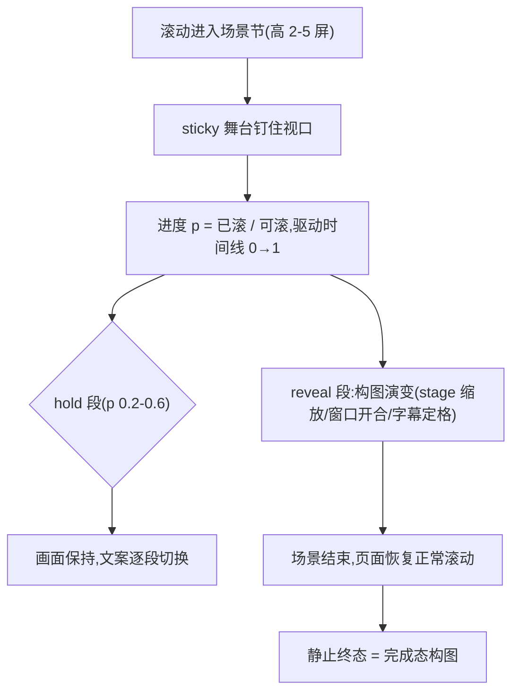

# 页面级滚动叙事场景（Scroll Scene）

> Framework 模板。**场景层**:sticky 舞台 + (hold+1) 屏高的节 + 进度驱动的时间线,页面级叙事动效。与交互级骨架的分界:那 10 篇管**元素级**动效(一张卡、一行列表怎么动),本篇管**整屏构图**如何随滚动演进——场景是构图不是装饰,必须随节次内容一起设计,不是内容写完后往上贴的效果。MOTION_INTENSITY 6-10 适用(见 [`../meta/dials.md`](../meta/dials.md));低于 6 的页面只允许本篇「静止终态」形态。

## 视觉效果



三个签名变体(选一,不叠加):

- **sticky-stage-scrub**:舞台钉住,进度擦洗构图演变(产品拆解/流程演示)
- **opening-window**:全屏图或色场从中缝/圆形开口展开,揭示下一节(章节转场)
- **held-picture-captions**:大图钉住,字幕逐段浮现更替(长图文叙事)

## 核心原则

1. **场景是构图**:先设计完成态(p=1 的静止画面,必须能当作品看),再反推过程——reduced motion、无 JS、脚本失败时用户看到的就是这个完成态
2. **密度纪律**:每页 2-3 个场景;两场景之间必须隔一个静默节(普通滚动内容)——连续场景互相抵消
3. **hold 节奏**:钉住保持 1-4 屏滚动距离;>4 屏用户会狂滚;hold 段的文案逐段切换,画面本体克制
4. **只吃原生滚动**:进度来自滚动位置,禁劫持滚轮;Lenis 类平滑滚动 lerp ≈ 0.12,且触屏与 reduced-motion 下必须关闭
5. **只动 transform / opacity / clip-path**:场景的层次感来自构图编排,不是属性堆料

## HTML 结构

```html
<section class="scene" style="--scene-hold: 3">
  <div class="scene__stage">        <!-- position: sticky; top: 0; height: 100vh -->
    <div class="scene__layer" data-phase="bg"></div>
    <div class="scene__layer" data-phase="figure"></div>
    <p class="scene__caption" data-step="1">…</p>
    <p class="scene__caption" data-step="2">…</p>
  </div>
</section>
```

## CSS

```css
.scene { height: calc(100vh * (var(--scene-hold) + 1)); }
.scene__stage { position: sticky; top: 0; height: 100vh; overflow: clip; }
.scene__caption { opacity: 0; transform: translateY(12px);
  transition: opacity .5s ease-out, transform .5s ease-out; }
.scene__caption.is-live { opacity: 1; transform: none; }
/* 完成态构图:JS 失败时 caption 至少显示第一段 */
.no-js .scene__caption[data-step="1"] { opacity: 1; transform: none; }
@media (prefers-reduced-motion: reduce) {
  .scene { height: auto; }
  .scene__stage { position: static; height: auto; }
  .scene__caption { opacity: 1; transform: none; }
}
```

## 原生 JavaScript(无依赖)

```js
const scenes = document.querySelectorAll('.scene');
const io = new IntersectionObserver((entries) => {
  for (const e of entries) e.target.__live = e.isIntersecting;
}, { rootMargin: '0px' });
scenes.forEach((s) => io.observe(s));

function frame() {
  for (const s of scenes) {
    if (!s.__live) continue;
    const stage = s.firstElementChild;
    const total = s.offsetHeight - innerHeight;       // 可滚程
    const p = Math.min(1, Math.max(0, -stage.offsetTop / total)); // 0→1
    // 进度直驱:构图参数全部由 p 插值(示例:窗口开合)
    stage.style.setProperty('--p', p.toFixed(4));
    // 字幕切换(hold 段)
    const step = Math.min(3, 1 + Math.floor(p * 3));
    s.querySelectorAll('.scene__caption').forEach((c) => {
      c.classList.toggle('is-live', +c.dataset.step === step);
    });
  }
  requestAnimationFrame(frame);
}
if (!matchMedia('(prefers-reduced-motion: reduce)').matches) requestAnimationFrame(frame);
```

场景层时长口径:reveal 段的**插值由滚动进度驱动,没有固定时长**;若含 in-view 触发的补间(开场窗 1100-1300ms 类),属场景层豁免档——必须可跳过(滚动越过即到完成态)且 reduced-motion 直接呈现完成态;UI 组件级装饰动效仍按 [`../vocabulary/micro-interactions.md`](../vocabulary/micro-interactions.md) 第 3 层 ≤600ms 执行,两层不混用。

## 强制规则

- **必须**实现 reduced-motion 降级:场景节退化为普通流式布局 + 完成态构图一次性呈现(见 [`../meta/accessibility.md`](../meta/accessibility.md) 第 2 节)
- **必须**只用原生滚动进度;进度计算用 rAF 节流,只处理视口内场景
- **完成态构图必须当作品设计**:禁把"空白舞台 + 等动画"当完成态;JS 失败时首帧可见内容完整
- **只动 transform / opacity / clip-path**;will-change 按公共兜底生命周期挂摘
- hold 屏数 1-4;场景占页面总长 >60% 即警告——叙事页不是无限剧场
- 数字类内容在场景内用纯文本("3 of 7"),不上 mono 计数器 chrome(与 [`../meta/ai-tells.md`](../meta/ai-tells.md) 计数器条一致)
- **逐帧验收**:交付前出 0/10/…/100% 十帧 contact sheet,桌面/手机/reduced 三份全读——场景的时间线错误只在中间帧暴露,首尾帧看不出来

## 失败模式

| 症状 | 根因 | 修法 |
| --- | --- | --- |
| 场景"跳变"不平滑 | hold 段与 reveal 段进度重叠 | 分段函数:每段只在 [a,b] 区间活动,段间缓冲 ≥0.05 |
| 手机上场景像幻灯片卡顿 | lerp 平滑未按触屏关闭 | 触屏直接用原生滚动进度,不叠加平滑 |
| 中间帧构图穿帮 | 只验了首尾帧 | 按逐帧验收出 contact sheet |
| 场景间互相抵消 | 场景背靠背无静默节 | 每两场景之间插一个普通滚动节 |
| 字幕重叠闪切 | caption 切换用瞬时 opacity | 交叉淡出 200-300ms,出比入先走 |
